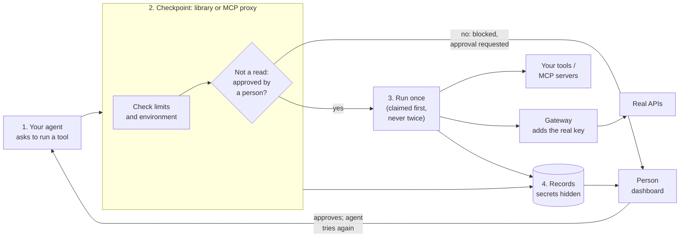
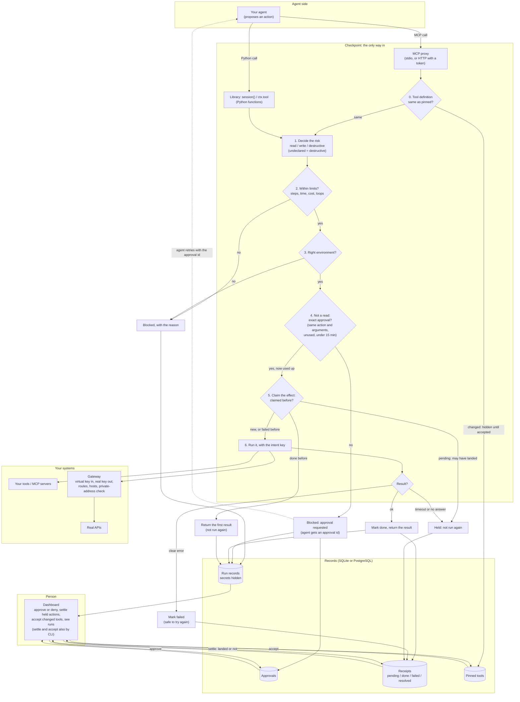
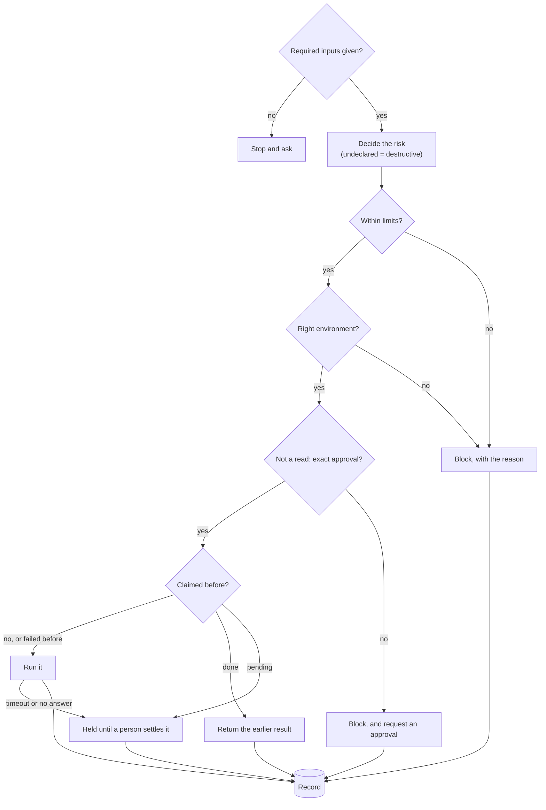

# Agent Action Gateway

[](https://github.com/GreyyDaze/agent-action-gateway/actions/workflows/ci.yml)

**Let AI agents change real systems safely. You control what they can do, and
you can prove what they did.**

## 1. Overview

AI agents call tools that change real systems: they delete tables, deploy code,
restart services. Called directly, there is **no control** (a wrong or
prompt-injected agent still acts) and **no proof** (no record of what it tried,
what ran, and what was refused).

This package puts a **checkpoint** between the agent and those tools. The agent
decides what to do. The checkpoint decides if it runs, and records it either way.

## 2. Key features

| | Problem | What the checkpoint does |
|---|---|---|
| **Control** | A risky action runs unseen | It waits until a person approves **that exact action**. The approval works once. |
| | The agent acts in the wrong environment | A `prod` tool is refused from a `dev` or `staging` session. |
| | A retry repeats the action | The same action does not run twice, even after a crash. |
| | The agent loops or runs too long | Limits on steps, time and cost stop the run. |
| | The agent holds the real API key | With the gateway, it never sees the key. |
| **Prove** | No record of what happened | Every checked action is recorded, with secrets hidden. A dashboard shows it, and is where a person approves, settles held actions and accepts changed tools. |
| | A reviewer approves without seeing why | Each approval carries what the agent read before asking, taken by the gateway and frozen with SHA-256, kept apart from the agent's own words. |
| | A new version may be less safe | A release gate tests it on your cases and fails if it got worse. |

Smaller features (stop and ask for a missing value, risk decided per call for
tools like `execute_sql`, tool pinning, the bypass scanner) are explained in the
[SDK guide](docs/sdk.md), the [gateway guide](docs/gateway-deployment.md) and the
[evaluation guide](docs/evaluation.md).

## 3. Technology stack

- **Python 3.11+, standard library only.** No required dependencies in a safety tool.
- **SQLite** by default, **PostgreSQL** optional: approvals and records survive a crash.
- **MCP** (stdio and Streamable HTTP) and **HTTP**, written without an SDK (why: section 8).
- **pytest, ruff, mypy** in CI on Python 3.11 to 3.13.

## 4. Core concepts

- **Risk class:** `read`, `write` or `destructive`. Anything undeclared is
  destructive. Everything except `read` needs an approval.
- **Exact approval:** bound to the action and its arguments, used once, expires
  after 15 minutes.
- **Waiting for approval vs held:** an action *waiting for approval* was blocked
  and has not run; a person approves or denies it. A *held* action was approved
  and sent, then got no answer (a timeout), so nobody knows if it happened. It is
  not run again until a person checks the real system and settles it.
- **Collected evidence:** the read results the agent got through the checkpoint
  before asking are frozen onto the approval, not written by the model. It is a
  copy of what the tools returned, not proof that it is true
  ([details and limits](docs/sdk.md#evidence-for-the-reviewer)).
- **Effect claim:** recorded *before* the action runs, keyed on what the action
  is. A retry finds it and gets the first result instead of acting again
  ([details](docs/receipt-guarantees.md)).
- **Pinning:** the MCP proxy saves each tool's definition; a changed tool is
  hidden until a person accepts it.
- **Virtual key:** the gateway holds the real key; the agent gets a key that only
  works for its allowed routes.

## 5. Architecture

How it works, in four steps:

1. **The agent asks.** Every tool call goes to the checkpoint (the library in
   Python, or the MCP proxy). The agent cannot reach your tools, the real keys or
   the records any other way.
2. **The checkpoint checks.** Limits, environment, and for anything that is not
   a read, an approval from a person for that exact call.
3. **It runs once.** The action is claimed before it runs, so a retry or crash
   never runs it twice. With the gateway, the real key is added there and the
   agent never sees it.
4. **Everything is recorded.** A person sees it in the dashboard, approves calls,
   settles actions with no clear result, and accepts changed tools.



<details>
<summary><b>Show every part and step</b></summary>



</details>

| Part | Use it when your agent calls | Checks | Guide |
|---|---|---|---|
| **Library** (`session()`) | Python functions | everything in section 6 | [SDK guide](docs/sdk.md#sessions) |
| **MCP proxy** (`agent-gateway mcp-proxy`) | MCP tools, started as a command or reached by URL (`--http`) | everything in section 6, plus pinning | [MCP proxy](docs/sdk.md#mcp-proxy) |
| **Gateway** (`agent-gateway gateway`) | HTTP APIs, key kept from the agent | routes, environment, key custody, approval (off when the route file holds keys); no limits or effect claim of its own | [gateway guide](docs/gateway-deployment.md) |

For full checks *and* key custody, put the gateway behind the proxy
([how](docs/gateway-deployment.md#behind-the-mcp-proxy)). Package layout:
[architecture](docs/architecture.md).

## 6. Execution flow

Every call goes through `enforce()` in this order. Nothing reaches the tool until
all checks pass, and every outcome is recorded.



The approval loop and the held path, step by step:
[architecture](docs/architecture.md#the-approval-loop-step-by-step).

## 7. Implementation

| Feature | Main files |
|---|---|
| Check pipeline | `engine/enforcement.py` |
| Sessions, wrapped tools, stop-and-ask | `runtime/session.py` |
| Approvals, limits | `policy/locks.py`, `policy/fuses.py` |
| Effect claims | `audit/receipts.py`, `policy/fingerprint.py` |
| MCP proxy, per-call risk | `integrations/mcp_proxy.py`, `guards/sql.py` |
| Gateway, key custody | `integrations/gateway.py`, `credential/` |
| Redaction | `guards/redaction.py` |

Wrap a tool and give the agent the wrapped version:

~~~python
from agent_action_gateway import session

def drop_table(table: str, intent_key: str = "") -> dict:
    # Your real code. Pass `intent_key` to your provider as an idempotency key.
    return {"dropped": table}

with session(environment="prod") as ctx:
    drop = ctx.tool(drop_table, action="db.drop_table", risk="destructive")

    drop(table="users")                       # blocked: needs approval

    approval = ctx.request_approval("db.drop_table", {"table": "users"})
    ctx.approve(approval.approval_id, "on-call engineer")
    drop(table="orders", approval_id=approval.approval_id)  # blocked: approval was for "users"
    drop(table="users", approval_id=approval.approval_id)   # allowed, and only once
~~~

Your agent is any function that takes the task and the tools:

~~~python
result = ctx.run(agent, task, tools={"drop_table": drop})
result["status"]   # "blocked" if any action was refused
~~~

More: [SDK guide](docs/sdk.md).

## 8. Technical decisions

| Decision | Why | Trade-off |
|---|---|---|
| Unknown means destructive | a forgotten tool must not run freely | new tools need a rule or an approval |
| Approval used once, for exact arguments | it cannot be reused for another action | a retry after a failure needs a new approval |
| Claim the effect before running | the only way to catch a repeat after a crash | needs a store that survives restarts |
| A proxy instead of changing MCP servers | works with servers you do not control | calls that skip the proxy are not checked |
| Keys in a separate gateway | an agent cannot leak a key it never had | one more service to run |
| MCP written without the SDK | no dependencies, full control in a security proxy; tested against the official SDK client | we follow MCP spec changes ourselves |
| Built-in release gate, not promptfoo or DeepEval | it reads the gateway's own records: blocked, approved and repeated actions | fewer features than those tools |

## 9. Failures, security and limits

- **Unknown result:** a timeout, a dropped connection, a 5xx or a crash mid-call
  may have landed, so the action is held and never repeated silently; settle it
  with `agent-gateway receipts`. A failure that proves nothing happened (a
  refused connection, a 4xx) may be retried, with the same intent key
  ([details](docs/receipt-guarantees.md#which-failures-may-be-retried)).
- **Dead MCP server:** restarted (at most 3 times a minute), tools re-checked
  against the pins. A broken config edit keeps the last good config.
- **Proxy isolation:** run with `--http` as its own user or container, so the
  agent cannot change its config or approvals; agents need a token
  ([details](docs/sdk.md#mcp-proxy)).
- **Secrets:** records are redacted before they are written.
- **Dashboard:** needs the token printed at start (then a strict cookie);
  refuses non-local addresses without one; every form has CSRF and origin checks.
  Approver names are typed, not verified.
- **Gateway:** refuses unregistered routes, hosts not on the allow-list, and
  names that resolve to private addresses.

**Limits:** it checks actions, not reasoning. It cannot detect a guessed value.
Only calls through the checkpoint are checked: an agent with a terminal can go
around it unless it runs where it has no keys and no direct network route to
your systems ([setups](docs/gateway-deployment.md#choosing-a-setup)). The SQL check cannot see inside
your own database functions. "Once" needs a provider idempotency key or lookup.
Not independently audited. ([full list](docs/gateway-deployment.md#known-limitations))

**Limits of the evidence on an approval:** it is the newest 10 reads that went
through the checkpoint, not only the ones about this action, and one proxy
serving several agents mixes their reads. An agent's own tools (its file or shell
tools) are not seen, so what it reads with them is not shown. There is no screen
or browser recording of the agent: the run's timeline records every checked call.
Without a read, there is no evidence. The dashboard shows it; `agent-gateway
receipts list` does not.

**Model usage (calls, tokens, cost):** the checkpoint sees tool calls, not the
agent's model calls, so it shows usage only when the agent reports it:
`record_model_exchange()` in the library, `POST /usage` on the proxy, or the
[Claude Code hook](integrations/claude-code/report_usage.mjs). Apps that do not
share their usage (Claude Desktop, Cursor) show "not reported". A reported cost
also counts as budget spend, so the cost limit covers model calls. The hook's cost
is the API list price; on a Claude subscription nothing is billed per token.

## 10. Testing

- About 760 automated tests, plus lint and type checks, in CI.
- `make proof`: 1,000 crashed retries cause **1** side effect; **0** destructive
  actions run without a valid approval.
- Run with Claude Code in the [demo](demo/README.md): the MCP proxy, a real
  Postgres MCP server and the gateway, on test databases. Not yet run with
  Claude Desktop or Cursor. PostgreSQL tests need a test database.

## 11. Setup

There is no hosted version. Everything runs on your machines, and nothing is sent to us.

| Part | How it runs |
|---|---|
| Library | inside your agent's Python code; no server |
| MCP proxy | started by your MCP client (stdio), or as a service you run (`--http`) |
| Gateway | a server you run; it holds the real keys |
| Dashboard | a local web page (127.0.0.1); to share it, put it behind your own sign-in |

```bash
pip install agent-action-gateway
```

Or the Docker image (amd64 and arm64): `docker pull ghcr.io/greyydaze/agent-action-gateway:0.3.0`.

| To | Run |
|---|---|
| check MCP tool calls | `agent-gateway mcp-proxy --config servers.json` |
| run the proxy as its own service | `agent-gateway mcp-proxy --config servers.json --http` |
| run the key-holding gateway | `agent-gateway gateway --config routes.json --db gateway.db` |
| approve, settle held actions, accept tools, see runs | `agent-gateway dashboard` |
| settle actions held with an unknown outcome | `agent-gateway receipts list` |
| find calls that skip the checkpoint | `agent-gateway check --app your_agent.py` (`--format json` for CI) |
| test a new agent version | `agent-gateway gate check --cases your-cases.json ...` ([guide](docs/evaluation.md)) |
| show Claude Code's tokens and cost | add [`report_usage.mjs`](integrations/claude-code/report_usage.mjs) as a `Stop` hook; set `AGENT_GATEWAY_USAGE_URL` and `AGENT_GATEWAY_PROXY_TOKEN` |

Secrets come from environment variables: the upstream keys named in the route
file, `AGENT_GATEWAY_MASTER_KEY`, `AGENT_GATEWAY_DASHBOARD_TOKEN`,
`AGENT_GATEWAY_PROXY_TOKEN` (proxy over HTTP), and `${NAME}`
in the proxy config. Run the gateway and the proxy where the agent cannot read
their keys, config or approvals (separate user, container or host).
[`deploy/`](deploy/) has a Compose setup for each, and `make verify-boundary` /
`make verify-proxy-boundary` check it from the agent's side; see the
[gateway guide](docs/gateway-deployment.md).

Develop: `pip install -e ".[dev]"`, then `make verify` and `make proof`.

## 12. Future direction

- **More usage adapters:** small hooks like the Claude Code one for other agents
  that keep a usage record, all sending to the same `POST /usage`.
- **A model proxy (only if asked for):** routing the agent's model traffic
  through the checkpoint would show usage for any agent that lets you set its
  API address, with no help from the agent. It makes the checkpoint a model
  proxy too, so it waits for real demand.
- **Verified approvers:** approver names are typed today; sign-in through your
  own identity provider would tie each approval to a real person.
- **More MCP clients tested:** Claude Desktop and Cursor, not only Claude Code.
- **An independent security review.**

## Documentation

| Guide | Read it for |
|---|---|
| [SDK guide](docs/sdk.md) | the library, approvals, limits, stop-and-ask, the [MCP proxy](docs/sdk.md#mcp-proxy) (rules, per-call risk, pinning, HTTP mode) |
| [Gateway guide](docs/gateway-deployment.md) | holding keys, deployment setups, checking your deployment, known limitations |
| [Receipt guarantees](docs/receipt-guarantees.md) | exactly what "once only" means |
| [Evaluation guide](docs/evaluation.md) | the release gate, `gate online`, `path`, `wall` |
| [Architecture](docs/architecture.md) | how the package is organized |
| [`deploy/`](deploy/) | Docker Compose for the gateway and the proxy, Kubernetes and systemd examples |

## License

MIT
