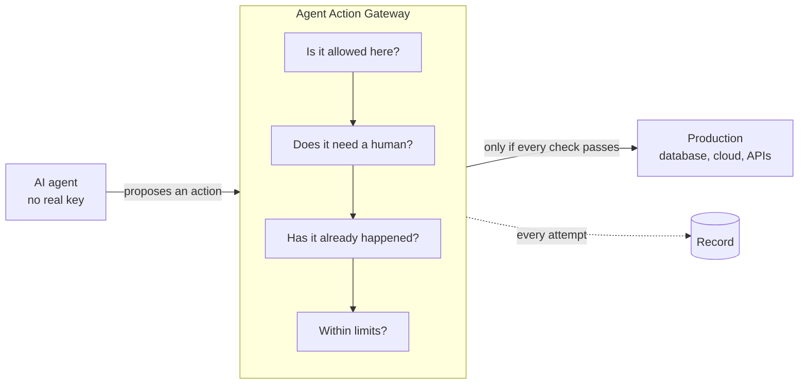
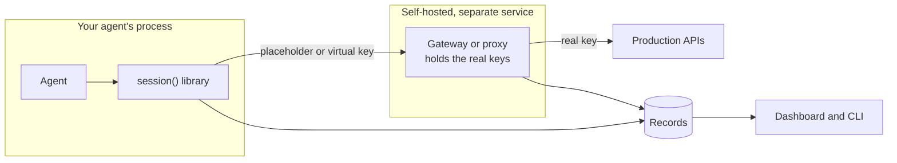

# Agent Action Gateway

[](https://github.com/GreyyDaze/agent-action-gateway/actions/workflows/ci.yml)

**Let AI agents change real systems safely. You control what they can do, and
you can prove what they did.**

## Contents

- [Why it exists](#why-it-exists)
- [What it does](#what-it-does)
- [How it ships](#how-it-ships)
- [Getting started](#getting-started)
- [Keep the key out of the agent](#keep-the-key-out-of-the-agent)
- [Prove what happened](#prove-what-happened)
- [Limits](#limits)
- [Documentation](#documentation)
- [Development](#development)

## Why it exists

### The problem

To change production, an AI agent needs a key: an API token, a database
password, a cloud credential. Today the agent usually holds that key itself.

So when the agent is confused, wrong, or tricked by a prompt injection, nothing
stands between its decision and the damage. It can delete a database, run the
same change twice after a timeout, or loop until the bill is huge. Afterwards,
nobody can say exactly what happened.

Most guardrails run inside the agent's own process. If the agent goes wrong,
the guardrail goes wrong with it.

### The idea

Move the key out of the agent, and make every action pass one checkpoint:



The agent still does its work. But it can only do what you allow, and every
attempt is recorded.

## What it does

### Control: the agent can only do what you allow

| Problem | What the gateway does |
|---|---|
| The agent holds the key | The gateway holds the key. The agent gets a placeholder that is useless anywhere else. |
| Risky actions have no checkpoint | A destructive action waits for a human to approve **that exact action**. An approval works once, and only for the arguments it names. |
| A retry repeats the action | Each real-world effect happens **once**, even after a crash, a restart, or a second worker. |
| The agent acts on a guess | If a required input is missing, the run stops and asks a person first. |
| The agent runs away | Limits on steps, time and cost stop it. Repeating the same call with no progress is stopped too. |
| The agent reaches the wrong place | A `dev` or `staging` session cannot reach `prod`. |
| Someone skips the gateway | `agent-gateway check` finds code paths that bypass it. |

### Prove: you can show what happened

| Problem | What the gateway does |
|---|---|
| Nobody can tell what happened | Every attempt, allowed or blocked, is recorded with secrets hidden, and shown in a dashboard. |
| Nobody knows if the agent got better or worse | A release gate tests each new agent version against your own cases before you ship it. |

### Measured, not claimed

These numbers come from proof suites that CI runs on every push, and at the
full 1,000 jobs every night. Reproduce them with `make proof`.

| Guarantee | Result |
|---|---|
| One effect, retried after crashes | **1 side effect** from 1,000 crashed retries, with a crash at a random point each time |
| Crash safety | **0 duplicates** across 1,000 crash jobs |
| Approval safety | **0 destructive actions** ran without a valid, fresh approval |
| Release gate | a planted regression is caught; unchanged code raises no false alarm |

## How it ships

It is one Python package. Some parts run inside your agent; others are
services **you host yourself**. There is no hosted service and no account.

| Part | What it is | Where it runs | You need it to |
|---|---|---|---|
| **Library** (`session()`) | Wraps your agent's tools | Inside your agent's process | Check every action: approval, once-only, limits |
| **CLI** (`agent-gateway`) | Commands for checking and reporting | Your machine or CI | Find bypasses, read records, run the release gate |
| **Gateway** (`agent-gateway gateway`) | HTTP service that holds the real keys | **Self-hosted**, as its own service | Keep the key out of the agent |
| **Outbound proxy** (`agent-gateway egress-serve`) | Swaps placeholders for real keys on allowed hosts | **Self-hosted**, as its own service | Keep the key out of the agent |
| **MCP server** (`agent-gateway mcp-serve`) | Serves guarded tools over MCP | **Self-hosted** | Protect agents that get tools over MCP |
| **Dashboard** | Web page for runs and approvals | **Self-hosted**, local by default | See runs and approve actions |

### Which setup do you need?

| You want | Use | Self-hosting needed |
|---|---|---|
| Approvals, once-only actions and limits on your agent's tools | the library | No |
| The agent unable to read or misuse the key, even if compromised | the library **and** the gateway or proxy | **Yes**: a separate service the agent cannot reach into |
| Tools served to an MCP client | the MCP server | **Yes** |



## Getting started

### Install

Python 3.11 or newer. The library has no third-party dependencies.

```bash
pip install agent-action-gateway
```

| Optional extra | Adds |
|---|---|
| `[postgres]` | PostgreSQL storage, for several hosts or gateway replicas |
| `[yaml]` | YAML route files |

### Protect a tool

Wrap your tool. Give the agent the wrapped version, never the raw function.

~~~python
from agent_action_gateway import session

def drop_table(table: str, intent_key: str = "") -> dict:
    # Your real code goes here. `intent_key` identifies this effect: pass it to
    # your provider as an idempotency key, so a retry cannot apply it twice.
    return {"dropped": table}

with session(environment="prod") as ctx:
    drop = ctx.tool(drop_table, action="db.drop_table", risk="destructive")

    drop(table="users")                       # blocked: needs approval

    approval = ctx.request_approval("db.drop_table", {"table": "users"})
    ctx.approve(approval.approval_id, "on-call engineer")
    drop(table="orders", approval_id=approval.approval_id)  # blocked: approval was for "users"
    drop(table="users", approval_id=approval.approval_id)   # allowed, and only once
~~~

### Run an agent

Pass the wrapped tools to your agent:

~~~python
result = ctx.run(agent, task, tools={"drop_table": drop})
result["status"]   # "blocked" if any action was refused
~~~

### Ask before acting

Name the inputs the task cannot proceed without. If one is missing, the agent
is not called; the run returns `needs_clarification` so a person can answer.

```python
result = ctx.run(agent, "Roll back the broken deployment",
                 tools=tools, required_inputs={"deployment_id": None})
result["status"]           # "needs_clarification"
result["missing_fields"]   # ("deployment_id",)
```

### Safe defaults

Everything is on with no configuration:

| Default | Value |
|---|---|
| Action with no declared risk | treated as **destructive** |
| Destructive action | needs a **fresh approval bound to the exact arguments** |
| Limits per run | **50 steps, 10 minutes, $2 of model and tool cost** (change with `limits=FuseLimits(...)`) |
| Environment | a session that is not `prod` cannot reach `prod` |

## Keep the key out of the agent

The library checks every call that goes through a wrapped tool. To make sure
the agent **cannot read the key at all**, run the gateway as a separate,
self-hosted service.

### Start the gateway

| Command | Use it when your agent |
|---|---|
| `agent-gateway gateway --config routes.json --db gateway.db` | calls your APIs through gateway routes |
| `agent-gateway egress-serve --config routes.json --port 8888` | makes its own HTTP calls through a proxy |
| `agent-gateway mcp-serve --config routes.json --db gateway.db` | gets its tools over MCP |

### Give the agent a placeholder

With the outbound proxy, the agent holds only a placeholder. The proxy swaps it
for the real secret, and only for the hosts you allow:

```json
{
  "credentials": [
    {
      "secret_name": "GITHUB_TOKEN",
      "secret_env": "file:/run/secrets/github_token",
      "allowed_hosts": ["api.github.com"],
      "header": "Authorization"
    }
  ]
}
```

### Check the boundary

This protection holds **only when the gateway runs across a boundary the agent
cannot cross**: a separate user, container or host. `deploy/` has ready setups
for systemd, Docker Compose and Kubernetes.

| Command | Checks |
|---|---|
| `agent-gateway gateway doctor --config routes.json` | this host: secret file permissions, user, master key, bind address |
| `make verify-boundary` | from the agent's position: can it reach a provider, read the secret, or call without a key? |

See [docs/gateway-deployment.md](docs/gateway-deployment.md) for each setup,
what it guarantees, and what it does not.

## Prove what happened

### Commands

| Command | Answers |
|---|---|
| `agent-gateway check --app myproject/agent.py` | Is every tool wrapped, or does some code bypass the gateway? |
| `agent-gateway check --db data/runtime.db` | Did any recorded action skip enforcement? |
| `agent-gateway wall --db data/runtime.db` | What broke, grouped by cause? |
| `agent-gateway path --db data/runtime.db` | Did each run get its result without trying something unsafe first? |
| `agent-gateway prune --db data/runtime.db --older-than 30 --dry-run` | Which recorded prompts can be discarded, keeping the evidence? |

### Dashboard

```bash
python -m agent_action_gateway.observability.dashboard --db data/runtime.db
```

It shows one run from top to bottom: each step, the effects and their
receipts, approvals waiting, and budget used. It needs the access token it
prints at start-up, and it runs no JavaScript.

### Release gate

Test a new agent version against your own cases before you ship it:

```bash
agent-gateway gate check --cases my-cases.json \
    --candidate-version v2 --candidate-file answers.json
```

| Verdict | Exit code | Meaning |
|---|---|---|
| PASS | `0` | at least as good as the recorded baseline |
| FAIL | `1` | a regression, or any failed case marked `catastrophic` |
| UNCERTAIN | `3` | no trustworthy verdict (`2` is a usage error) |

See [docs/evaluation.md](docs/evaluation.md) for the case format and how the
optional LLM judge is kept honest.

## Limits

| It does **not** | Because |
|---|---|
| decide whether the agent's plan is correct | that is your engineer's judgement |
| stop hallucinations | it checks actions, not reasoning |
| replace human approval | it enforces it |
| guarantee exactly-once when your provider has no idempotency key and no lookup | nobody can tell whether such an effect landed |
| keep the key from an agent in the same process | that needs the self-hosted gateway |

Deferred work and non-goals are listed in [ROADMAP.md](ROADMAP.md).

## Documentation

| Guide | Read it to |
|---|---|
| [SDK guide](docs/sdk.md) | use sessions, tools, approvals, limits and stop-and-ask |
| [Gateway deployment](docs/gateway-deployment.md) | self-host the gateway, and see what it defends against |
| [Receipt guarantees](docs/receipt-guarantees.md) | understand exactly what "once" means |
| [Evaluation](docs/evaluation.md) | write cases, run the release gate, read path scores |
| [Architecture](docs/architecture.md) | see how the package is organized |

## Development

```bash
python -m venv .venv && source .venv/bin/activate
pip install -e ".[dev]"
make verify     # lint, type check, full test suite
make proof      # reproduce every number in "Measured, not claimed"
```

## License

MIT
