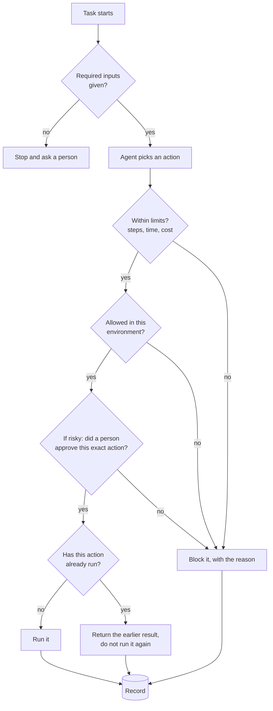

# Agent Action Gateway

[](https://github.com/GreyyDaze/agent-action-gateway/actions/workflows/ci.yml)

**Let AI agents change real systems safely. You control what they can do, and
you can prove what they did.**

## The problem

An AI agent picks actions and calls tools to do them. Some tools change real
systems: they delete a table, deploy code, or restart a service. When the agent
calls such a tool directly:

- **There is no control.** The action runs even if the agent is wrong or was
  tricked by a prompt injection.
- **There is no proof.** No clear record shows what the agent tried, what ran,
  and what was refused.

## The idea

Put a checkpoint between the agent and the tools that change things. The agent
decides what to do. The checkpoint decides if it runs, and records it either
way.

The checks happen in this order:



## What it does

Each row is one check from the diagram, in the same order.

| | Problem | What the checkpoint does |
|---|---|---|
| **Control** | The agent guesses a missing input | If you marked the input as required, the run stops and asks a person. |
| | The agent loops or runs too long | Limits on steps, time and cost stop the run. |
| | The agent acts in the wrong environment | A tool marked `prod` is refused from a `dev` or `staging` session. |
| | A risky action runs unseen | It waits until a person approves **that exact action**. The approval works once. |
| | A retry repeats the action | The same action does not run twice, even after a crash. |
| | The agent holds the key | With the gateway (below), the agent never sees the real key. |
| **Prove** | No record of what happened | Every checked action is recorded, with secrets hidden. |
| | No way to tell if a new version is safer | A release gate tests it on your own cases, and fails if it got worse. |

Tested, not just claimed: in `make proof`, 1,000 crashed retries cause **1**
side effect, and **0** destructive actions run without a valid approval.

## Install

Python 3.11 or newer:

```bash
pip install agent-action-gateway
```

## Connect your agent

How your agent calls its tools decides which part you use:

| If your agent calls | Use | How |
|---|---|---|
| Python functions | the library | wrap the functions with `session()`, as in the example below |
| tools on MCP servers | the MCP proxy | `agent-gateway mcp-proxy --config servers.json`: your agent connects to the proxy only, and the proxy connects to the MCP servers you list (local or remote) |
| APIs over HTTP, with the key kept away from the agent | the gateway | send the calls to `agent-gateway gateway` instead of the API |

What each one checks:

| | Library | MCP proxy | Gateway |
|---|---|---|---|
| Limits (steps, time, cost, loops) | yes | yes | no |
| Environment | yes | yes | yes |
| Approval of the exact action | yes | yes | yes, unless the route file has a `credentials` block |
| Once-only effect | yes | yes | only through the upstream's `Idempotency-Key` |
| Stop and ask for a missing input | yes | yes, for the arguments a tool requires | no |
| Key kept from the agent | no | no | yes, run as its own service |

Three things to know:

- **The proxy checks only the calls that go through it.** If your agent can also
  reach a real MCP server directly, those calls are not checked. List only the
  proxy in your agent's config.
- **The proxy needs no routes.** It reads each server's tool list. A tool counts
  as read-only only if you say so in a rule, or if its server marks it
  `readOnlyHint` and you trust that server. Every other tool needs an approval.
  A tool whose definition later changes is held back until you accept it, and
  edits to the config apply without a restart.
- **Keeping the key from the agent** works only with the gateway, run as its own
  service where the agent cannot reach it. See the
  [gateway guide](docs/gateway-deployment.md).

### Example: the library

Wrap your tool, and give the agent the wrapped version:

~~~python
from agent_action_gateway import session

def drop_table(table: str, intent_key: str = "") -> dict:
    # Your real code goes here. `intent_key` identifies this effect: pass it to
    # your provider as an idempotency key, so a retry cannot apply it twice.
    return {"dropped": table}

with session(environment="prod") as ctx:
    drop = ctx.tool(drop_table, action="db.drop_table", risk="destructive")

    drop(table="users")                       # blocked: needs approval

    approval = ctx.request_approval("db.drop_table", {"table": "users"})
    ctx.approve(approval.approval_id, "on-call engineer")
    drop(table="orders", approval_id=approval.approval_id)  # blocked: approval was for "users"
    drop(table="users", approval_id=approval.approval_id)   # allowed, and only once
~~~

Your agent is any function that takes the task and the tools. Give it the
wrapped tools:

~~~python
result = ctx.run(agent, task, tools={"drop_table": drop})
result["status"]   # "blocked" if any action was refused
~~~

## See what happened

| To | Run |
|---|---|
| see each run step by step, and approve waiting actions | `agent-gateway dashboard` |
| find code that calls around the checkpoint | `agent-gateway check --app your_agent.py` |
| test a new agent version before you ship it | `agent-gateway gate check --cases your-cases.json ...` ([evaluation guide](docs/evaluation.md)) |

## Limits

It checks actions, not reasoning: it does not judge the agent's plan or stop
hallucinations. It cannot promise "once" if your provider has no idempotency
key and no lookup. Deferred work is in [ROADMAP.md](ROADMAP.md).

## Documentation

- [SDK guide](docs/sdk.md): sessions, approvals, limits, stop-and-ask
- [Gateway deployment](docs/gateway-deployment.md): self-hosting and what it protects
- [Receipt guarantees](docs/receipt-guarantees.md): exactly what "once" means
- [Evaluation](docs/evaluation.md): the release gate and run scoring
- [Architecture](docs/architecture.md): how the package is organized

## Development

```bash
pip install -e ".[dev]"
make verify     # lint, type check, tests
make proof      # reproduce the numbers above
```

## License

MIT
