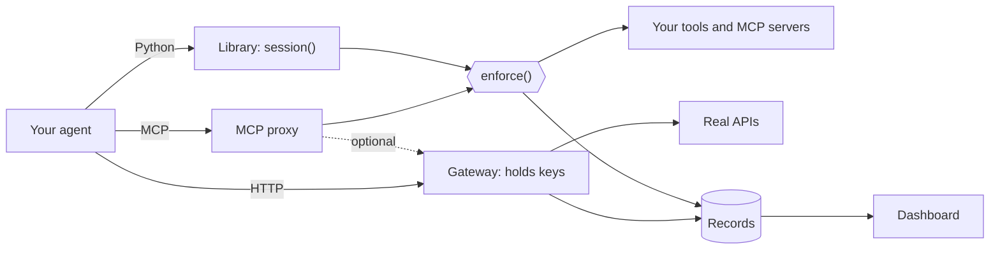
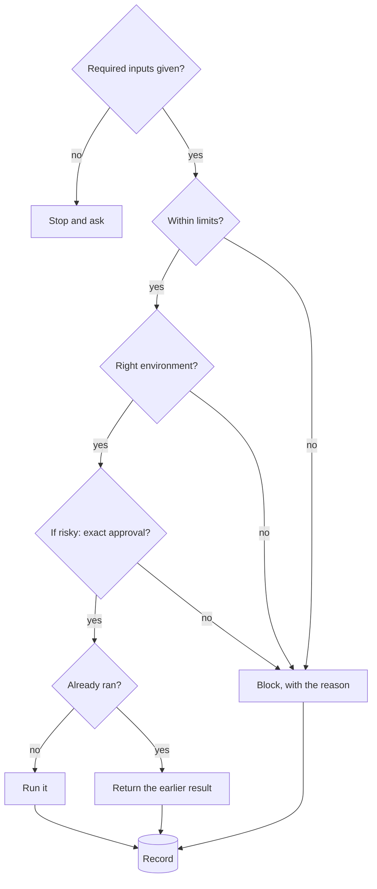

# Agent Action Gateway

[](https://github.com/GreyyDaze/agent-action-gateway/actions/workflows/ci.yml)

**Let AI agents change real systems safely. You control what they can do, and
you can prove what they did.**

## 1. Overview

AI agents call tools that change real systems: they delete tables, deploy code,
restart services. Called directly, there is **no control** (a wrong or
prompt-injected agent still acts) and **no proof** (no record of what it tried,
what ran, and what was refused).

This package puts a **checkpoint** between the agent and those tools. The agent
decides what to do. The checkpoint decides if it runs, and records it either way.

## 2. Key features

| | Problem | What the checkpoint does |
|---|---|---|
| **Control** | A risky action runs unseen | It waits until a person approves **that exact action**. The approval works once. |
| | The agent acts in the wrong environment | A `prod` tool is refused from a `dev` or `staging` session. |
| | A retry repeats the action | The same action does not run twice, even after a crash. |
| | The agent loops or runs too long | Limits on steps, time and cost stop the run. |
| | The agent holds the real API key | With the gateway, it never sees the key. |
| **Prove** | No record of what happened | Every checked action is recorded, with secrets hidden. A dashboard shows it, and is where a person approves, settles held actions and accepts changed tools. |
| | A new version may be less safe | A release gate tests it on your cases and fails if it got worse. |

Smaller features (stop and ask for a missing value, risk decided per call for
tools like `execute_sql`, tool pinning, the bypass scanner) are explained in the
[SDK guide](docs/sdk.md), the [gateway guide](docs/gateway-deployment.md) and the
[evaluation guide](docs/evaluation.md).

## 3. Technology stack

- **Python 3.11+, standard library only.** No required dependencies in a safety tool.
- **SQLite** by default, **PostgreSQL** optional: approvals and records survive a crash.
- **MCP** (stdio and Streamable HTTP) and **HTTP**, written without an SDK (why: section 8).
- **pytest, ruff, mypy** in CI on Python 3.11 to 3.13.

## 4. Core concepts

- **Risk class:** `read`, `write` or `destructive`. Anything undeclared is
  destructive. Everything except `read` needs an approval.
- **Exact approval:** bound to the action and its arguments, used once, expires
  after 15 minutes.
- **Effect claim:** recorded *before* the action runs, keyed on what the action
  is. A retry finds it and gets the first result instead of acting again
  ([details](docs/receipt-guarantees.md)).
- **Pinning:** the MCP proxy saves each tool's definition; a changed tool is
  hidden until a person accepts it.
- **Virtual key:** the gateway holds the real key; the agent gets a key that only
  works for its allowed routes.

## 5. Architecture



| Part | Use it when your agent calls | Checks | Guide |
|---|---|---|---|
| **Library** (`session()`) | Python functions | everything in section 6 | [SDK guide](docs/sdk.md#sessions) |
| **MCP proxy** (`agent-gateway mcp-proxy`) | MCP tools, started as a command or reached by URL (`--http`) | everything in section 6, plus pinning | [MCP proxy](docs/sdk.md#mcp-proxy) |
| **Gateway** (`agent-gateway gateway`) | HTTP APIs, key kept from the agent | routes, environment, key custody, approval (off when the route file holds keys); no limits or effect claim of its own | [gateway guide](docs/gateway-deployment.md) |

For full checks *and* key custody, put the gateway behind the proxy
([how](docs/gateway-deployment.md#behind-the-mcp-proxy)). Package layout:
[architecture](docs/architecture.md).

## 6. Execution flow

Every call goes through `enforce()` in this order. Nothing reaches the tool until
all checks pass, and every outcome is recorded.



## 7. Implementation

| Feature | Main files |
|---|---|
| Check pipeline | `engine/enforcement.py` |
| Sessions, wrapped tools, stop-and-ask | `runtime/session.py` |
| Approvals, limits | `policy/locks.py`, `policy/fuses.py` |
| Effect claims | `audit/receipts.py`, `policy/fingerprint.py` |
| MCP proxy, per-call risk | `integrations/mcp_proxy.py`, `guards/sql.py` |
| Gateway, key custody | `integrations/gateway.py`, `credential/` |
| Redaction | `guards/redaction.py` |

Wrap a tool and give the agent the wrapped version:

~~~python
from agent_action_gateway import session

def drop_table(table: str, intent_key: str = "") -> dict:
    # Your real code. Pass `intent_key` to your provider as an idempotency key.
    return {"dropped": table}

with session(environment="prod") as ctx:
    drop = ctx.tool(drop_table, action="db.drop_table", risk="destructive")

    drop(table="users")                       # blocked: needs approval

    approval = ctx.request_approval("db.drop_table", {"table": "users"})
    ctx.approve(approval.approval_id, "on-call engineer")
    drop(table="orders", approval_id=approval.approval_id)  # blocked: approval was for "users"
    drop(table="users", approval_id=approval.approval_id)   # allowed, and only once
~~~

Your agent is any function that takes the task and the tools:

~~~python
result = ctx.run(agent, task, tools={"drop_table": drop})
result["status"]   # "blocked" if any action was refused
~~~

More: [SDK guide](docs/sdk.md).

## 8. Technical decisions

| Decision | Why | Trade-off |
|---|---|---|
| Unknown means destructive | a forgotten tool must not run freely | new tools need a rule or an approval |
| Approval used once, for exact arguments | it cannot be reused for another action | a retry after a failure needs a new approval |
| Claim the effect before running | the only way to catch a repeat after a crash | needs a store that survives restarts |
| A proxy instead of changing MCP servers | works with servers you do not control | calls that skip the proxy are not checked |
| Keys in a separate gateway | an agent cannot leak a key it never had | one more service to run |
| MCP written without the SDK | no dependencies, full control in a security proxy; tested against the official SDK client | we follow MCP spec changes ourselves |
| Built-in release gate, not promptfoo or DeepEval | it reads the gateway's own records: blocked, approved and repeated actions | fewer features than those tools |

## 9. Failures, security and limits

- **Unknown result:** a timeout, a dropped connection, a 5xx or a crash mid-call
  may have landed, so the action is held and never repeated silently; settle it
  with `agent-gateway receipts`. A failure that proves nothing happened (a
  refused connection, a 4xx) may be retried, with the same intent key
  ([details](docs/receipt-guarantees.md#which-failures-may-be-retried)).
- **Dead MCP server:** restarted (at most 3 times a minute), tools re-checked
  against the pins. A broken config edit keeps the last good config.
- **Proxy isolation:** run with `--http` as its own user or container, so the
  agent cannot change its config or approvals; agents need a token
  ([details](docs/sdk.md#mcp-proxy)).
- **Secrets:** records are redacted before they are written.
- **Dashboard:** needs the token printed at start (then a strict cookie);
  refuses non-local addresses without one; every form has CSRF and origin checks.
  Approver names are typed, not verified.
- **Gateway:** refuses unregistered routes, hosts not on the allow-list, and
  names that resolve to private addresses.

**Limits:** it checks actions, not reasoning. It cannot detect a guessed value.
Only calls through the checkpoint are checked: an agent with a terminal can go
around it unless it runs where it has no keys and no direct network route to
your systems ([setups](docs/gateway-deployment.md#choosing-a-setup)). The SQL check cannot see inside
your own database functions. "Once" needs a provider idempotency key or lookup.
Not independently audited. ([full list](docs/gateway-deployment.md#known-limitations))

## 10. Testing

- About 675 automated tests, plus lint and type checks, in CI.
- `make proof`: 1,000 crashed retries cause **1** side effect; **0** destructive
  actions run without a valid approval.
- Tried once with Claude Code against the MCP proxy (test tools); not yet with
  Claude Desktop or Cursor. PostgreSQL tests need a test database.

## 11. Setup

```bash
pip install agent-action-gateway
```

| To | Run |
|---|---|
| check MCP tool calls | `agent-gateway mcp-proxy --config servers.json` |
| run the proxy as its own service | `agent-gateway mcp-proxy --config servers.json --http` |
| run the key-holding gateway | `agent-gateway gateway --config routes.json --db gateway.db` |
| approve, settle held actions, accept tools, see runs | `agent-gateway dashboard` |
| settle actions held with an unknown outcome | `agent-gateway receipts list` |
| find calls that skip the checkpoint | `agent-gateway check --app your_agent.py` (`--format json` for CI) |
| test a new agent version | `agent-gateway gate check --cases your-cases.json ...` ([guide](docs/evaluation.md)) |

Secrets come from environment variables: the upstream keys named in the route
file, `AGENT_GATEWAY_MASTER_KEY`, `AGENT_GATEWAY_DASHBOARD_TOKEN`,
`AGENT_GATEWAY_PROXY_TOKEN` (proxy over HTTP), and `${NAME}`
in the proxy config. Run the gateway and the proxy where the agent cannot read
their keys, config or approvals (separate user, container or host).
[`deploy/`](deploy/) has a Compose setup for each, and `make verify-boundary` /
`make verify-proxy-boundary` check it from the agent's side; see the
[gateway guide](docs/gateway-deployment.md).

Develop: `pip install -e ".[dev]"`, then `make verify` and `make proof`.

## Documentation

| Guide | Read it for |
|---|---|
| [SDK guide](docs/sdk.md) | the library, approvals, limits, stop-and-ask, the [MCP proxy](docs/sdk.md#mcp-proxy) (rules, per-call risk, pinning, HTTP mode) |
| [Gateway guide](docs/gateway-deployment.md) | holding keys, deployment setups, checking your deployment, known limitations |
| [Receipt guarantees](docs/receipt-guarantees.md) | exactly what "once only" means |
| [Evaluation guide](docs/evaluation.md) | the release gate, `gate online`, `path`, `wall` |
| [Architecture](docs/architecture.md) | how the package is organized |
| [`deploy/`](deploy/) | Docker Compose for the gateway and the proxy, Kubernetes and systemd examples |

## License

MIT
