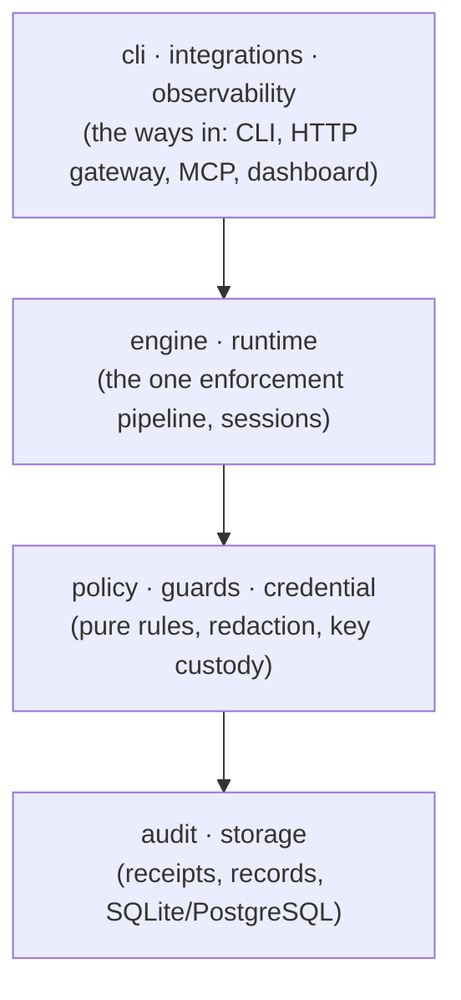
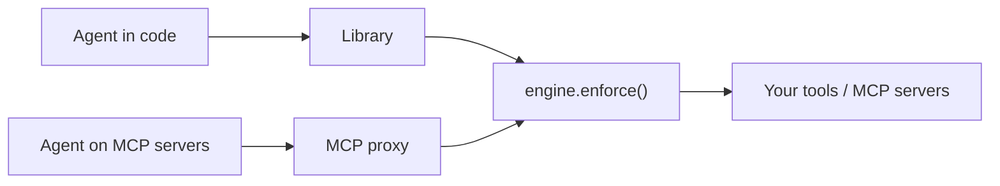
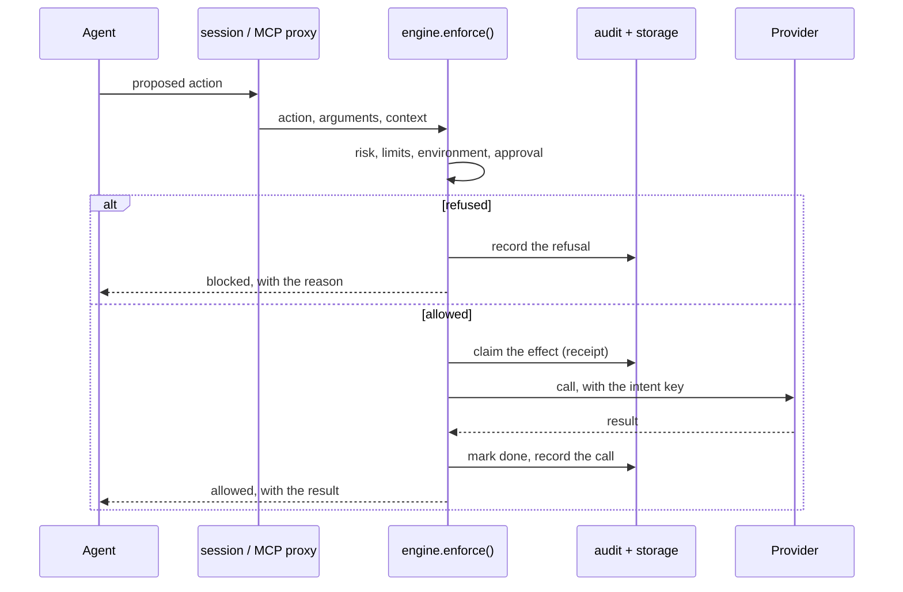

# Architecture

How the package is organized, and how one action flows through it.

## Contents

- [Layers](#layers)
- [Package map](#package-map)
- [How an action flows](#how-an-action-flows)
- [Configuration](#configuration)
- [Testing](#testing)

## Layers

Dependencies point **downward only**. A lower layer never imports a higher one.

| Layer | Rule |
|---|---|
| `policy/` | pure decision logic, with no I/O |
| `engine/` | the checking pipeline; the library and the MCP proxy call it |
| `credential/` | the only place real secrets are handled |
| `storage/` | the leaf: imports nothing above it |

## Package map

| Package | Job |
|---|---|
| `policy/` | rules: risk, approval, limits, stop-and-ask, effect fingerprints |
| `engine/` | `enforce()`, the checking pipeline |
| `guards/` | redaction, capture policy, honest run status |
| `runtime/` | `session()`, records, lower-level dispatch helpers |
| `credential/` | placeholder vault, secret resolvers, outbound proxy, TLS |
| `integrations/` | MCP proxy, HTTP gateway, route-based MCP server, provider interface |
| `audit/` | receipts, failure grouping, case promotion |
| `eval/` | cases, judges, verdicts, release gate, run sampling, path scoring |
| `storage/` | SQLite and PostgreSQL persistence |
| `observability/` | dashboard and bypass detection |
| `proofs/` | verification suites about this library, and their test doubles |

## How an action flows

A wrapped tool (the library) and the MCP proxy both call `engine.enforce()`, so
they check the same things. The HTTP gateway and the route-based `mcp-serve` do
not: they check the environment and (in the default mode) approval, and hold the
key. See the table in the README for what each one checks.

The flow for the library and the proxy:

## Configuration

The package ships **example** configuration only: the route files in
`deploy/`. You write your own in your project (your hosts, keys, risks and
limits) and the gateway reads it. No live policy lives in this repository.

## Testing

| Command | Runs |
|---|---|
| `make verify` | lint, type check, full test suite |
| `make test-unit` | fast tests with no I/O |
| `make test-integration` | database, socket and server tests |
| `make test-evals` | evaluation suites |
| `make proof` | every guarantee suite, with the numbers the README quotes |
| `make mutation` | mutation testing of the safety code (nightly) |

Test lanes are assigned in `tests/conftest.py`. Mutation testing (`mutmut`)
changes the safety code (`policy/`, `engine/`, `audit/`, `credential/`,
`guards/`) and reports any change no test noticed, which coverage cannot show.
It is a development tool only; the package itself has no dependencies.
