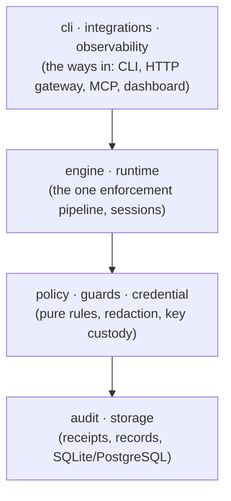
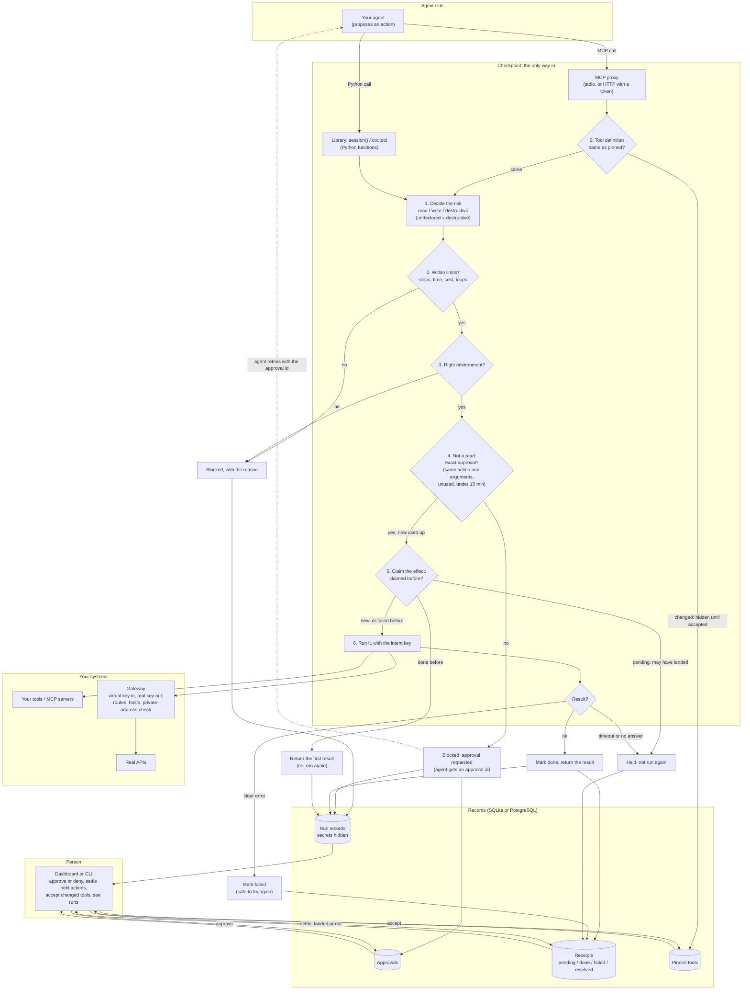

# Architecture

How the package is organized, and how one action flows through it.

## Contents

- [Layers](#layers)
- [Package map](#package-map)
- [How it works](#how-it-works)
- [Configuration](#configuration)
- [Testing](#testing)

## Layers

Dependencies point **downward only**. A lower layer never imports a higher one.



| Layer | Rule |
|---|---|
| `policy/` | decision logic. One exception holds state: `locks.py` keeps the approval store (SQLite) |
| `engine/` | the checking pipeline; the library and the MCP proxy call it |
| `credential/` | the only place real secrets are handled |
| `storage/` | the leaf: imports nothing above it |

## Package map

| Package | Job |
|---|---|
| `policy/` | rules: risk, approval, limits, stop-and-ask, effect fingerprints |
| `engine/` | `enforce()`, the checking pipeline |
| `guards/` | redaction, capture policy, honest run status, the SQL read check |
| `runtime/` | `session()`, records, lower-level dispatch helpers |
| `credential/` | placeholder vault, secret resolvers, outbound host checks |
| `integrations/` | MCP proxy (stdio, or HTTP with `mcp-connect`), HTTP gateway, route-based MCP server, provider interface |
| `audit/` | receipts, failure grouping, case promotion |
| `eval/` | cases, judges, verdicts, release gate, run sampling, path scoring |
| `storage/` | SQLite and PostgreSQL persistence |
| `observability/` | dashboard and bypass detection |
| `proofs/` | verification suites about this library, and their test doubles |

## How it works

One picture of the whole system: every part, and every step an action takes.
The numbers are the order of the checks. The agent reaches only the checkpoint,
never your tools, the real keys or the records.



What each part does:

| Part | Job |
|---|---|
| **Agent** | proposes actions. It holds no real key and cannot write approvals or records. |
| **Library** | wraps your Python tools; each call goes through the checks. |
| **MCP proxy** | sits between the agent and MCP servers; pins tool definitions, then runs the same checks. |
| **Checks 1 to 6** | one code path, `engine.enforce()`, used by both the library and the proxy. |
| **Gateway** | holds the real API key. The agent gets a virtual key that works only for its routes. Behind the proxy, it does not ask for a second approval. |
| **Records** | approvals (with their frozen evidence), receipts (the claim made *before* running), run records with secrets hidden, and pinned tools. |
| **Person** | decides in the dashboard or CLI. Only a person can approve, settle a held action or accept a changed tool. |

Used **directly** (agent → gateway, no proxy), the gateway and its `/mcp`
endpoint check routes, environment, key custody and approval, but not limits or
the effect claim. For all checks and key custody, put it behind the proxy.

### The approval loop, step by step

```mermaid
sequenceDiagram
    participant Agent
    participant CP as Checkpoint (library or proxy)
    participant Store as Records
    participant Person as Person (dashboard or CLI)
    participant Tool as Tool or gateway

    Agent->>CP: delete_branch(name="old")
    CP->>CP: 1-3. risk destructive, limits ok, environment ok
    CP->>Store: 4. no approval: save a request for this exact call
    CP-->>Agent: blocked, approval id A1
    Person->>Store: read the request (action, arguments, risk, run)
    Person->>Store: approve A1
    Agent->>CP: same call again, with A1
    CP->>Store: 4. A1 matches the exact arguments: use it up
    CP->>Store: 5. claim the effect (receipt pending)
    CP->>Tool: 6. run, with the intent key
    alt ok
        Tool-->>CP: result
        CP->>Store: receipt done, record the call
        CP-->>Agent: allowed, with the result
    else timeout or no answer
        CP->>Store: receipt stays pending (held)
        CP-->>Agent: error; a retry is refused, not run twice
        Person->>Store: check the real system, settle: landed or not
    end
```

## What the checks cost

Measured with `python benchmarks/overhead.py` on an Apple M1, Python 3.12, SQLite
on the local disk, with tools that do no work, so these are the cost of the checks
alone (median of 400 calls; run it yourself, the numbers move from run to run and
roughly double on a busy machine, so the ranges below span both):

| Call | Without the checks | With the checks |
|---|---|---|
| Library, read tool | under 0.01 ms | about 3 to 7 ms |
| Library, destructive tool, approved (claim, receipt, record) | under 0.01 ms | about 13 to 20 ms |
| MCP proxy, read tool | about 0.04 ms (straight to the server) | about 3 to 7 ms |
| MCP proxy, destructive tool, approved | about 0.04 ms | about 13 to 18 ms |

Keeping a read result for [automatic evidence](sdk.md#collected-automatically)
(one JSON encoding and one SHA-256, in memory) did not change these numbers.

Nearly all of it is SQLite writes (the trace, the receipt, the approval). A real
tool call (a network request, a database query) is usually far slower than this,
and a PostgreSQL store will have its own cost. Reads are cheap; the extra time is
for actions that change something.

## Configuration

The package ships **example** configuration only: the route files in
`deploy/`. You write your own in your project (your hosts, keys, risks and
limits) and the gateway reads it. No live policy lives in this repository.

## Testing

| Command | Runs |
|---|---|
| `make verify` | lint, type check, full test suite |
| `make test-unit` | every test file not listed as integration, evals or live; fast, though some use a temporary SQLite file |
| `make test-integration` | database, socket and server tests |
| `make test-evals` | evaluation suites |
| `make proof` | every guarantee suite, with the numbers the README quotes |
| `make mutation` | mutation testing of the safety code (nightly) |

Test lanes are assigned in `tests/conftest.py`. Mutation testing (`mutmut`)
changes the safety code (`policy/`, `engine/`, `audit/`, `credential/`,
`guards/`) and reports any change no test noticed, which coverage cannot show.
It is a development tool only; the package itself has no dependencies.
