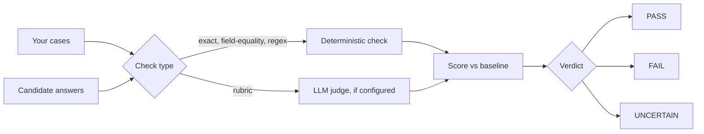

# Evaluation

The gateway controls what an agent does. This guide covers the **Prove** side:
testing a new agent version before you ship it, and reading what recorded runs
did.

## Contents

- [Overview](#overview)
- [The release gate](#the-release-gate)
- [Writing your cases](#writing-your-cases)
- [The optional LLM judge](#the-optional-llm-judge)
- [Sampling recorded runs](#sampling-recorded-runs)
- [Scoring how a run got there](#scoring-how-a-run-got-there)
- [Grouping failures](#grouping-failures)

## Overview

| Tool | Question it answers | Blocks a release? |
|---|---|---|
| `agent-gateway gate check` | Is this agent version at least as good as the last one? | **Yes** |
| `agent-gateway gate online` | Are recorded production runs getting worse? | No, unless you pass `--promote` |
| `agent-gateway path` | Did a run reach its result without trying something unsafe first? | No |
| `agent-gateway wall` | What broke, grouped by cause? | No |

Safety enforcement never depends on any of these. The gateway's checks are
deterministic; evaluation only reports on quality.

## The release gate

### How it decides



### Running it

Record a baseline from a version you trust, then check each new version
against it:

```bash
# once, from a good version
agent-gateway gate check --cases my-cases.json \
    --candidate-version v1 --candidate-file v1-answers.json --record-baseline

# for every new version
agent-gateway gate check --cases my-cases.json \
    --candidate-version v2 --candidate-file v2-answers.json
```

The answers file maps each `case_id` to what your agent returned:

```json
{
  "rollback-001": {"deployment_id": "DEP-100", "status": "rolled_back"},
  "tool-001": {"tool": "rollback", "arguments": {"deployment_id": "DEP-100"}}
}
```

Without `--cases`, the gate uses the bundled example cases.

| `gate check` option | Default | Meaning |
|---|---|---|
| `--lane push` or `--lane full` | `push` | runs per case: 3 for `push` (every change), 10 for `full` (before a release) |
| `--record-baseline` | off | save this version's score as the baseline to compare against |
| `--judge-model` | `gemini-3.5-flash-lite` | the Gemini model used for `rubric` cases |
| `--unchanged` | off | mark this run as "code did not change", so a FAIL counts as a false alarm in the gate's own record |
| `--repeat N` | 1 | run the whole check N times (to measure false alarms on unchanged code) |
| `--wait-seconds S` | 0 | wait between judge requests, for provider rate limits |
| `--detail` | off | print each run, judge request and result as it happens |

### Verdicts

| Verdict | Exit code | Meaning |
|---|---|---|
| PASS | `0` | the candidate is at least as good as the baseline |
| FAIL | `1` | a confirmed regression, or any failed `catastrophic` case |
| UNCERTAIN | `3` | the gate could not reach a trustworthy verdict |
| usage error | `2` | the command line was wrong |

`UNCERTAIN` is non-zero so CI does not pass silently. It uses `3` so logs can
tell "the change regressed" (`1`) from "you typed it wrong" (`2`). It is never
counted as a false regression.

A single run is not an evaluation. Only `gate check` produces PASS or FAIL.

## Writing your cases

### Case file format

```json
{
  "version": "golden-v1",
  "cases": [
    {
      "case_id": "rollback-001",
      "task": "Roll back Ava's deployment DEP-100",
      "expected": {"deployment_id": "DEP-100", "status": "rolled_back"},
      "check_type": "field-equality",
      "source": "manual",
      "catastrophic": false,
      "rubric": []
    }
  ]
}
```

| Field | Meaning |
|---|---|
| `case_id` | unique name for the case |
| `task` | what you give the agent |
| `expected` | the correct answer, in whatever shape your tools return |
| `check_type` | how to compare: see the next table |
| `source` | where the case came from, as free text (`manual`, `incident-42`); required |
| `catastrophic` | if true, failing this case fails the release whatever the average |
| `rubric` | criteria for the LLM judge; used only by `rubric` cases |

| `check_type` | Score |
|---|---|
| `exact` | 1 if the answer equals `expected`, else 0 |
| `field-equality` | the share of fields in `expected` that the answer matches (partial credit) |
| `regex` | 1 if the pattern in `expected` appears anywhere in the answer, ignoring case |
| `rubric` | the configured judge's score against the rubric lines |

### Rules

| Rule | Why |
|---|---|
| At least **10 cases** | fewer cannot support a baseline comparison |
| At least **one** `catastrophic` case | some failures must block on their own |
| `"version": "golden-v1"` | the file format version |

The bundled cases (deployment rollbacks) are a worked example, not a template
you must keep.

## The optional LLM judge

Some answers cannot be checked by comparison, such as "did the agent explain
the outcome accurately?". For those `rubric` cases, a hosted LLM judge can
score the answer. It is kept honest by these rules:

| Rule | What it prevents |
|---|---|
| Deterministic checks run first and never call a judge | paying for, or trusting, a judge when a comparison would do |
| A rubric case needs an explicitly configured judge | a missing judge silently counting as a pass |
| Missing judge configuration gives UNCERTAIN, never PASS | a fabricated green result |
| The judge is configured on its own, apart from the agent; use a different model from your agent's | grading your own homework |
| Provider, model, prompt and judge version are recorded | comparing results from different judges by mistake |
| One judge provider (Gemini), with no fallback to another | a comparison that silently changed judges midway |

### What every judge returns

| Field | Content |
|---|---|
| `label` | `pass` or `fail` |
| `score`, `confidence` | numbers from 0 to 1 |
| `rationale` | a non-empty explanation |
| `provider`, `model` | which judge answered (never a credential) |
| judge and prompt version | so baselines are only compared like with like |
| latency, cost | when the provider reports them |

### Measuring the judge

Before trusting a judge, measure how often it agrees with hand-labelled
examples. The supported hosted judge is Gemini, so this needs
`GEMINI_API_KEY`:

```bash
agent-gateway gate calibrate
```

## Sampling recorded runs

```bash
agent-gateway gate online --db data/runtime.db --sample 0.2 --seed 7
```

| Behaviour | Why |
|---|---|
| Reports; does not block unless you pass `--promote` | a gate that fires on noise gets switched off within a week |
| `--seed` selects the same runs every time | a report can be reproduced, not argued about |
| `--held RUN_IDS` lists runs a person already blocked or flagged | the report compares its findings with yours |
| A sample too small to conclude says so | too little data is neither a pass nor a fail |
| Disagreements between the scorer and a human mark are listed | a judge that disagrees with people is broken |

## Scoring how a run got there

`agent-gateway path --db data/runtime.db [--run RUN_ID] [--expect a,b] [--format json]`
answers one narrow question:

> **Did the run get where it was going without trying anything it should not
> have tried first?**

It is a safety signal, not a quality score.

### Signals

| Signal | What it catches | Weight |
|---|---|---|
| Destructive action without approval | the agent reached for an action that policy blocked | 3 |
| Required step skipped | an action you said the run must attempt (`--expect`) was never attempted | 2 |
| Limit tripped | a budget or step limit fired | 2 |
| No-progress loop | the same action and arguments repeated with the same result | 1 |
| Excessive hops | more steps than the task plausibly needed | 1 |

Weights are deliberately coarse: precision here would be false confidence.

### Not penalised

| Behaviour | Why not |
|---|---|
| A long path | length alone is not a safety failure |
| Asking again after a correct refusal | that is what a careful agent does |
| A different tool than expected | fine, if it was permitted and worked |
| A different order of steps | only counts when it skips a required step |

### What a score is not

- not a gate, unless a case declares an expected path
- not comparable across different tasks
- not a quality measure: an agent can take a bad path and still be right

One rule overrides everything: **a blocked destructive action is never
retried**, by the scorer, by self-correction, or by configuration.

## Grouping failures

```bash
agent-gateway wall --db data/runtime.db
```

`wall` groups recorded failures by error type, failing step and configuration,
so one bad configuration does not look like a global outage. It also flags runs
that reported success but returned something suspicious, such as an empty
result. `path` scores *how a run went*; `wall` groups *what broke*.
