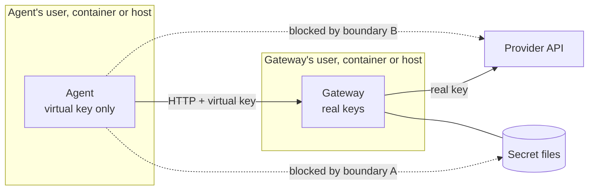

# Gateway Deployment

The gateway holds your upstream keys so your agent never sees them. This guide
covers how to self-host it, how to check it worked, and what it defends
against.

## Contents

- [The one condition](#the-one-condition)
- [Two boundaries](#two-boundaries)
- [Choosing a setup](#choosing-a-setup)
- [Connecting your agent](#connecting-your-agent)
- [Checking your deployment](#checking-your-deployment)
- [What it defends against](#what-it-defends-against)
- [Known limitations](#known-limitations)

## The one condition

> **The gateway must run as its own service, across a boundary your agent
> cannot cross.** If it runs inside your agent's process, your agent can read
> the same environment the key came from, and nothing is protected.

No Python library can create that boundary; your operating system does. What
this project does is refuse deployments that have none, ship reference ones,
and tell you whether yours holds.



## Two boundaries

A vault is not a boundary. It is lifecycle: short-lived keys, rotation, audit.
It limits how long a leaked key is useful, but does not stop an agent that has
the key, or one that can reach the provider with it. You need both of these:

| Boundary | Stops | Provided by |
|---|---|---|
| **A. Cannot read the key** | the agent reading an env var, a file, or the gateway's memory | OS users, container mounts, `LoadCredential=`, a vault the agent cannot reach |
| **B. Cannot reach the provider** | the agent calling the API with a key it somehow obtained | firewall, Kubernetes NetworkPolicy, container egress rules |

### What the gateway enforces itself

| Check | Result |
|---|---|
| Secret file is mode `0600` | **Enforced**: refused otherwise |
| Secret file is owned by the gateway's user | **Enforced**: refused otherwise |
| Launched as root | **Enforced**: drops to a service account first |
| Caller runs as the gateway's own user (Linux, unix socket) | **Enforced**: rejected using the kernel's `SO_PEERCRED` |
| Embedded in an agent's script | **Signalled**, not guaranteed: an embed through `python -c`, `exec()` or a REPL is not detected |
| Agent cannot reach a provider | **Not checkable here**: it is a network fact; run `make verify-boundary` |
| Agent actually uses the gateway | **Not checkable here**: run `agent-gateway check --app` |

## Choosing a setup

| Setup | Boundary A | Boundary B | Files | Use for |
|---|---|---|---|---|
| **Same process** | none | none | — | refused: there is nothing to protect |
| **Separate OS user** | kernel | your firewall | `deploy/systemd/` | minimum |
| **Separate containers** | container | Docker networks | `deploy/docker-compose.yml` | self-hosting (recommended) |
| **Separate host** | node | NetworkPolicy | `deploy/k8s/gateway.yaml` | production |

### Same process: refused

```python
from agent_action_gateway.integrations.gateway import build_gateway_server   # refused
```

The gateway refuses to start this way, because a green result would be a claim
the deployment cannot support.

### Separate OS user

`systemd`'s `User=` and `LoadCredential=` mean the agent's user cannot read the
gateway's environment (`/proc/<pid>/environ`) or attach to it with `ptrace`.

### Separate containers

Two networks, and the gateway is the only service on both. Your agent joins
`agent_net` only. The file deliberately has no `agent:` service: you already
have an agent, and a fake one would prove only that the file is written
correctly.

#### Does your agent need the internet?

Almost always: an agent that calls a deployment API also calls a model API.
Plain Compose cannot allow one host and block the rest, so there are two files:

| | `docker-compose.yml` (default) | `+ docker-compose.egress.yml` |
|---|---|---|
| Agent reaches a model API | no | yes |
| A leaked key is usable from the agent | no | **yes** |
| `make verify-boundary` | `BOUNDARY HELD` | fails, correctly |

The default fails closed on purpose. Turning egress on is legitimate, but the
guarantee then rests on your credentials and provider settings, not on the
network:

```bash
docker compose -f docker-compose.yml -f docker-compose.egress.yml up -d
COMPOSE_FILES="-f docker-compose.yml -f docker-compose.egress.yml" make verify-boundary
```

Back it with scoped short-lived keys, an egress policy that allows the model
API and denies the deployment API (Cilium or DNS-based egress control), or
provider-side key restrictions.

### Separate host

Two NetworkPolicies: one limits who may reach the gateway, the other limits the
agent's egress to the gateway and DNS. **There is deliberately no rule allowing
`api.github.com`**, which is what makes a leaked key useless. Bind the
gateway's ServiceAccount to your provider's workload identity so it holds no
static key at all.

## Connecting your agent

### Issue a key per agent

There is no client library to install: your agent calls the gateway over HTTP
with a **virtual key** scoped to the routes it may use.

```bash
agent-gateway gateway --config routes.json --db gateway.db \
    issue-key --name deploy-agent --ttl 1h --routes /deploy
```

| Key command | Does |
|---|---|
| `issue-key --name N --ttl 1h --routes /a,/b` | creates a key for those routes only |
| `list-keys` | shows issued keys |
| `revoke-key KEY` | stops a key immediately, with no restart |
| `rotate-master` | prints a new master key; existing keys stay valid until they expire |

### Call a route

```bash
curl -X POST http://gateway:8080/deploy \
  -H "Authorization: Bearer $VIRTUAL_KEY" \
  -H "Idempotency-Key: deploy-shop-api-v2" \
  -d '{"ref": "v2"}'
```

| Header | Purpose |
|---|---|
| `Authorization: Bearer <virtual key>` | who is calling |
| `X-Approval-Id` | the approval for a held destructive action |
| `Idempotency-Key` | identifies the effect, so a retry cannot repeat it |

An agent with a key for `/deploy` gets `403` on `/rollback`. An unregistered
path is refused the same way, so the gateway does not reveal which routes
exist.

### Status codes

| Status | Meaning | Client should |
|---|---|---|
| `401` | no key, unknown, expired or revoked | re-authenticate; do not retry blindly |
| `403` | the route is not in this key's scope | request a key with that route |
| `403` + `needs_approval: true` | held until a person approves | get an approval, then retry |
| `502` | the upstream could not be reached | retry later; the action did not happen |

### Unix socket mode (Linux)

`--unix-socket PATH` is the one mode where the kernel backs the custody claim
directly: the gateway reads the caller's user id and refuses a caller running
as its own user, whatever key they present. Verified on Linux:

| Caller user | Gateway user | Result |
|---|---|---|
| 1001 | 1001 | `403`: no boundary between them |
| 0 | 1001 | reaches policy |

A refused caller does not stop the gateway; it keeps serving others.

## Checking your deployment

Two commands, answering different questions:

| Command | Runs from | Checks | Cannot check |
|---|---|---|---|
| `agent-gateway gateway doctor --config routes.json` | the gateway host | its user, secret file owner and mode, master key, bind address | whether the agent can reach a provider |
| `make verify-boundary` | the agent's network | can it reach a provider, read the secret, or call without a key? | whether the agent behaves correctly |

`make verify-boundary` attaches a temporary container to your agent's network
and tries to escape. It uses only the standard library, because a probe that
imports this project could not tell this project's code from an attacker's. It
exits **2 when it cannot run**, never 0: "could not check" is not "passed".

```text
BOUNDARY NOT HELD: 1 check(s) failed: A  no route to a provider
  REACHABLE api.github.com:443 from the agent's network. A bypass would
  succeed here, so no credential boundary exists.
```

### What a green result means

| Result | Proves | Does **not** prove |
|---|---|---|
| `make verify-boundary` passes | the network blocks direct provider access | that the agent uses the gateway |
| `agent-gateway check --app` passes | the agent's code routes through the gateway | that the network holds |
| **Both pass** | boundary **and** wiring | — |

Neither replaces the other. A perfect network with an agent that calls the
provider directly is unprotected; a perfectly wired agent whose gateway runs in
its own process holds no boundary.

## What it defends against

The gateway's own attack surface is where it holds authority:

| Area | Defence |
|---|---|
| **Approval endpoints** | The dashboard can approve destructive actions, so every route needs a per-process token, with CSRF and origin checks. It binds to `127.0.0.1` and refuses any other address unless a token is set explicitly. |
| **Credential custody** | Upstream keys are read from the gateway's own environment or files, and never returned to a caller or written to a record. |
| **Secrets in records** | Records are redacted before they are written: keys, tokens, card numbers, IBANs, national ID numbers and contact details. Run ids and idempotency keys are kept, because they are the evidence. |
| **Approval binding** | An approval is bound to a digest of the exact payload and consumed on use. A changed payload is refused, and so is a reused approval. |

## Known limitations

Stated plainly, because a security tool that overstates itself is worse than
none:

| Limitation | What to do |
|---|---|
| Only tools obtained from a `session()` are checked | run `agent-gateway check --app` to find direct calls |
| A record cannot show an action that never reached the gateway | use `check --app` (static); `check --db` reports `INCONCLUSIVE` on an empty database |
| Bypass detection covers known provider clients and direct network calls | an unusual call shape may go unnoticed |
| In the same process, code can reach the database and the key directly | use the self-hosted gateway |
| Custody depends on the deployment, not the code | follow a setup above, and run `make verify-boundary` |
| Recorded prompts keep anything redaction does not recognise (names, free text) | prune with `agent-gateway prune`; nothing is deleted automatically |
| No transport encryption is enforced | use `https` upstreams in production |
| An approval is not tied to the session that asked for it | deliberate: it allows approving ahead of time; approvals are still single-use and payload-bound |
| A failed action still uses up its approval | deliberate: a partial effect cannot always be ruled out, so the retry needs a fresh approval |
| Not independently audited | the evidence is automated: `make proof`, `agent-gateway check`, and CI on Python 3.11 to 3.13 |
