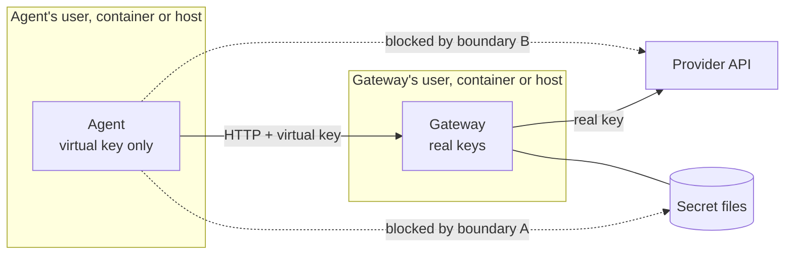
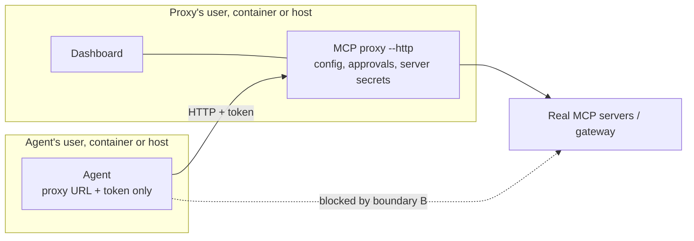

# Gateway Deployment

The gateway holds your upstream keys so your agent never sees them. This guide
covers how to self-host it, how to check it worked, and what it defends
against.

## Contents

- [The one condition](#the-one-condition)
- [Two boundaries](#two-boundaries)
- [Choosing a setup](#choosing-a-setup)
- [Connecting your agent](#connecting-your-agent)
- [Route file reference](#route-file-reference)
- [Running the MCP proxy as a service](#running-the-mcp-proxy-as-a-service)
- [Checking your deployment](#checking-your-deployment)
- [What it defends against](#what-it-defends-against)
- [Known limitations](#known-limitations)

## The one condition

> **The gateway must run as its own service, across a boundary your agent
> cannot cross.** If it runs inside your agent's process, your agent can read
> the same environment the key came from, and nothing is protected.

No Python library can create that boundary; your operating system does. What
this project does is refuse deployments that have none, ship reference ones,
and tell you whether yours holds.



## Two boundaries

A vault is not a boundary. It is lifecycle: short-lived keys, rotation, audit.
It limits how long a leaked key is useful, but does not stop an agent that has
the key, or one that can reach the provider with it. You need both of these:

| Boundary | Stops | Provided by |
|---|---|---|
| **A. Cannot read the key** | the agent reading an env var, a file, or the gateway's memory | OS users, container mounts, `LoadCredential=`, a vault the agent cannot reach |
| **B. Cannot reach the provider** | the agent calling the API with a key it somehow obtained | firewall, Kubernetes NetworkPolicy, container egress rules |

### What the gateway enforces itself

| Check | Result |
|---|---|
| Secret file is mode `0600` | **Enforced**: refused otherwise |
| Secret file is owned by the gateway's user | **Enforced**: refused otherwise |
| Launched as root | **Enforced**: drops to a service account first |
| Caller runs as the gateway's own user (Linux, unix socket) | **Enforced**: rejected using the kernel's `SO_PEERCRED` |
| Embedded in an agent's script | **Signalled**, not guaranteed: an embed through `python -c`, `exec()` or a REPL is not detected |
| Agent cannot reach a provider | **Not checked by the gateway**: it is a network fact, so test it from the agent's side ([how](#checking-your-deployment)) |
| Agent actually uses the gateway | **Not checked by the gateway**: run `agent-gateway check --app` |

## Choosing a setup

| Setup | Boundary A | Boundary B | Files | Use for |
|---|---|---|---|---|
| **Same process** | none | none | — | refused: there is nothing to protect |
| **Separate OS user** | kernel | your firewall | `deploy/systemd/` | minimum |
| **Separate containers** | container | Docker networks | `deploy/docker-compose.yml` | self-hosting (recommended) |
| **Separate host** | node | NetworkPolicy | `deploy/k8s/gateway.yaml` | production |

### Same process: refused

```python
from agent_action_gateway.integrations.gateway import build_gateway_server   # refused
```

The gateway refuses to start this way, because a green result would be a claim
the deployment cannot support.

### Separate OS user

`systemd`'s `User=` and `LoadCredential=` mean the agent's user cannot read the
gateway's environment (`/proc/<pid>/environ`) or attach to it with `ptrace`.

### Separate containers

Two networks, and the gateway is the only service on both. Your agent joins
`agent_net` only. The file deliberately has no `agent:` service: you already
have an agent, and a fake one would prove only that the file is written
correctly.

#### Does your agent need the internet?

Almost always: an agent that calls a deployment API also calls a model API.
Plain Compose cannot allow one host and block the rest, so there are two files:

| | `docker-compose.yml` (default) | `+ docker-compose.egress.yml` |
|---|---|---|
| Agent reaches a model API | no | yes |
| A leaked key is usable from the agent | no | **yes** |
| `verify-boundary` | `BOUNDARY HELD` | fails, correctly |

The default fails closed on purpose. Turning egress on is legitimate, but the
guarantee then rests on your credentials and provider settings, not on the
network:

```bash
docker compose -f docker-compose.yml -f docker-compose.egress.yml up -d
COMPOSE_FILES="-f docker-compose.yml -f docker-compose.egress.yml" make verify-boundary
```

Back it with scoped short-lived keys, an egress policy that allows the model
API and denies the deployment API (Cilium or DNS-based egress control), or
provider-side key restrictions.

### Separate host

Two NetworkPolicies: one limits who may reach the gateway, the other limits the
agent's egress to the gateway and DNS. **There is deliberately no rule allowing
`api.github.com`**, which is what makes a leaked key useless. Bind the
gateway's ServiceAccount to your provider's workload identity so it holds no
static key at all.

## Connecting your agent

### Issue a key per agent

There is no client library to install: your agent calls the gateway over HTTP
with a **virtual key** scoped to the routes it may use.

```bash
agent-gateway gateway --config routes.json --db gateway.db \
    issue-key --name deploy-agent --ttl 1h --routes /deploy
```

| Key command | Does |
|---|---|
| `issue-key --name N --ttl 1h --routes /a,/b` | creates a key for those routes only |
| `list-keys` | shows issued keys |
| `revoke-key KEY` | stops a key immediately, with no restart |
| `rotate-master` | prints a new master key; existing keys stay valid until they expire |

### Call a route

```bash
curl -X POST http://gateway:8080/deploy \
  -H "Authorization: Bearer $VIRTUAL_KEY" \
  -H "Idempotency-Key: deploy-shop-api-v2" \
  -d '{"ref": "v2"}'
```

| Header | Purpose |
|---|---|
| `Authorization: Bearer <virtual key>` | who is calling |
| `X-Approval-Id` | the approval for a destructive action that was blocked |
| `Idempotency-Key` | identifies the effect, so a retry cannot repeat it |

An agent with a key for `/deploy` gets `403` on `/rollback`. An unregistered
path gets the same answer (`route not available for this key`), so a scoped key
cannot tell which routes exist.

### Status codes

| Status | Meaning | Client should |
|---|---|---|
| `400` | the body is not a JSON object | fix the request |
| `401` | no key, unknown, expired or revoked | re-authenticate; do not retry blindly |
| `403` | the route is not in this key's scope, or does not exist | request a key with that route |
| `403` + `needs_approval: true` | blocked until a person approves | get an approval, then retry |
| `502` | the upstream could not be reached | retry later; the action did not happen |
| `503` | the gateway cannot read the route's credential | the operator fixes the secret (`gateway doctor`); the reason is in the gateway's record, not the reply |

### Behind the MCP proxy

The gateway also serves its routes as MCP tools at `POST /mcp` (Streamable HTTP,
one JSON request per call). This lets the [MCP proxy](sdk.md#mcp-proxy) forward
to it: the proxy runs the checks (limits, approval, once-only), and the gateway
adds the real credential and makes the call.

- Authenticate with a virtual key in `Authorization: Bearer`. A scoped key sees
  only its routes as tools, and asking for any other tool gets the same answer as
  asking for one that does not exist.
- A route with `risk: read` is listed as read-only, so the proxy treats it as
  read when you trust the gateway's hints.
- The proxy sends its idempotency key in the request's `_meta`
  (`agent-action-gateway/intent_key`), and the gateway forwards it upstream as
  `Idempotency-Key`.
- Run the gateway without its own approval check: a route file with a
  `credentials` block (as in `deploy/routes.credentials.example.json`) does that
  unless it sets `enforce_policy: true`. Otherwise each destructive call would need
  an approval in the proxy and another in the gateway.
- A route in that mode must point at a hostname the gateway accepts: it refuses
  `localhost` and literal private addresses as upstreams. It also looks the name up,
  and refuses it if it points at a loopback, private or cloud-metadata address. After
  it connects, it checks the address it really reached, so a name that changes its
  answer between the check and the call (DNS rebinding) is stopped too. If a route
  must reach an internal service on purpose, list its hostname in `private_hosts` in
  the route file. That skips the private-address check for that name only. The
  cloud-metadata range (`169.254.0.0/16`) stays blocked.
- `/mcp` is reserved: a route cannot use that path.

### Unix socket mode (Linux)

`--unix-socket PATH` is the one mode where the kernel backs the custody claim
directly: the gateway reads the caller's user id and refuses a caller running
as its own user, whatever key they present. Checked by hand in a Linux container
(no automated test covers it, because `SO_PEERCRED` is Linux-only):

| Caller user | Gateway user | Result |
|---|---|---|
| 1001 | 1001 | `403`: no boundary between them |
| 0 | 1001 | reaches policy |

A refused caller does not stop the gateway; it keeps serving others.

## Route file reference

JSON, or YAML with `pip install 'agent-action-gateway[yaml]'`. Examples:
`deploy/routes.example.json` and `deploy/routes.credentials.example.json`.

| Top-level key | Default | Meaning |
|---|---|---|
| `routes` | none | the only paths the gateway forwards |
| `session_environment` | `dev` | the gateway's environment: a route bound to another one is refused |
| `master_key_env` | none | the variable holding the admin key that issues and revokes virtual keys |
| `credentials` | none | turns on custody mode: the gateway holds these secrets, and its own approval check is off unless `enforce_policy` is true |
| `enforce_policy` | `false` | with `credentials`: also run the gateway's approval check |
| `allowed_hosts` | each credential's hosts | with `credentials`: hosts any request may reach |
| `private_hosts` | none | internal hostnames a route may reach on purpose (the metadata range stays blocked) |

| Route key | Default | Meaning |
|---|---|---|
| `path` | required | the path the agent calls, e.g. `/deploy` (`/mcp` is reserved) |
| `upstream` | required | the real URL the gateway forwards to |
| `action` | required | the action name in approvals and records |
| `risk` | `destructive` | `read`, `write` or `destructive` |
| `method` | `POST` | must be `POST`: the gateway serves POST only |
| `secret_env` | none | the upstream key: a variable name, or `file:/path` (mode 0600, owned by the gateway's user) |
| `environment` | `prod` | where the route acts |

| Credential key | Meaning |
|---|---|
| `secret_name` | the placeholder name the agent sees |
| `secret_env` | the real secret: a variable name or `file:/path` |
| `allowed_hosts` | hostnames (not IP addresses) this secret may be sent to; required |
| `header` | if set, the gateway adds the secret in this header itself; if not, the agent puts the placeholder where the key goes |

## Running the MCP proxy as a service

The same rule applies to the [MCP proxy](sdk.md#mcp-proxy). Started by the
agent's app over stdio, it runs as the agent's own user: an agent with a
terminal or file access could change its config, approve itself through its
database, or read the real servers' secrets. Run it with `--http` across the
same two boundaries instead:



| Lives on the proxy's side | Lives on the agent's side |
|---|---|
| `servers.json`, the database (approvals, records), the real servers' secrets, network access to the real systems, the dashboard | the proxy's URL and a token (`AGENT_GATEWAY_PROXY_TOKEN`), nothing else |

```bash
AGENT_GATEWAY_PROXY_TOKEN=... agent-gateway mcp-proxy --config servers.json \
    --db proxy.db --http --host 0.0.0.0 --port 8090
```

- **Boundary A:** run it as its own OS user or container, so the agent cannot
  read `servers.json`, the database or the secrets.
- **Boundary B:** the agent's network reaches the proxy and nothing else that
  matters: no route to the database or the APIs the tools change. This is what
  makes a terminal harmless: the agent can run commands in its own box, but has
  no key to steal and no other way out.
- **HTTPS:** across machines, put a TLS reverse proxy in front; `mcp-connect`
  refuses plain `http` to another machine.
- **Approvals:** run the dashboard on the proxy's side, against the same
  database. The agent's token cannot approve anything.
- **Keys for HTTP APIs:** list the gateway as one of the proxy's servers
  ([Behind the MCP proxy](#behind-the-mcp-proxy)), so the proxy runs the checks
  and the gateway holds the key.

**Reference setup:** `deploy/docker-compose.proxy.yml` runs the proxy, the
gateway behind it and the dashboard beside it, on separate networks, and
`make verify-proxy-boundary` checks it from the agent's side
([deploy/README](../deploy/README.md#the-mcp-proxy)). There is no Kubernetes
file for the proxy yet; the Compose file shows the shape to copy.

## Checking your deployment

Two commands, answering different questions:

| Command | Runs from | Checks | Cannot check |
|---|---|---|---|
| `agent-gateway gateway doctor --config routes.json` | the gateway host | its user, the owner and mode of every secret file (routes and the `credentials` block), master key, bind address (beyond this machine is a warning) | whether the agent can reach a provider; the MCP proxy |
| `agent-gateway verify-boundary --gateway URL --key KEY` | the agent's machine or network | can it reach a provider, read the secret, or call without a key? | whether the agent behaves correctly |
| `agent-gateway verify-boundary --target proxy --proxy URL --token TOKEN` | the agent's machine or network | the same for the proxy: can it skip the proxy, call it without a token, or read its config and database? | whether the agent behaves correctly |

Run the probe where the agent runs, because the result describes the network it
runs on. It tries to reach a provider and the secret from there. It uses only
the standard library, and its file imports nothing from this package, so it also
runs as a single file in a bare Python container. It exits **2 when it cannot
run**, never 0: "could not check" is not "passed". In the repository,
`make verify-boundary` and `make verify-proxy-boundary` run it from a container
on the Compose setup's agent network.

```text
   FAIL  A  no route to a provider
         REACHABLE api.github.com:443 from the agent's network. An upstream key
         that leaked for any reason would be usable from here, so this barrier
         is absent. ...

BOUNDARY NOT HELD: 1 check(s) failed: A  no route to a provider
```

It exits 0 when every check passes, 1 when one fails, and 2 when any could not
run.

### What a green result means

| Result | Proves | Does **not** prove |
|---|---|---|
| `verify-boundary` passes | the network blocks direct provider access | that the agent uses the gateway |
| `agent-gateway check --app` passes | the agent's code routes through the gateway | that the network holds |
| **Both pass** | boundary **and** wiring | — |

Neither replaces the other. A perfect network with an agent that calls the
provider directly is unprotected; a perfectly wired agent whose gateway runs in
its own process holds no boundary.

## What it defends against

The gateway's own attack surface is where it holds authority:

| Area | Defence |
|---|---|
| **Approval endpoints** | The dashboard can approve destructive actions, so every route needs a per-process token, with CSRF and origin checks. It binds to `127.0.0.1` and refuses any other address unless a token is set explicitly. |
| **Credential custody** | Upstream keys are read from the gateway's own environment or files, and never returned to a caller or written to a record. |
| **Secrets in records** | Records are redacted before they are written: keys, tokens, card numbers, IBANs, national ID numbers and contact details. Run ids and idempotency keys are kept, because they are the evidence. |
| **Approval binding** | An approval is bound to a digest of the exact payload and consumed on use. A changed payload is refused, and so is a reused approval. |

## Known limitations

| Limitation | What to do |
|---|---|
| Only tools obtained from a `session()` are checked | run `agent-gateway check --app` to find direct calls |
| A record cannot show an action that never reached the gateway | use `check --app` (static); `check --db` reports `INCONCLUSIVE` on an empty database |
| Bypass detection covers known provider clients and direct network calls | an unusual call shape may go unnoticed |
| In the same process, code can reach the database and the key directly | use the self-hosted gateway |
| Custody depends on the deployment, not the code | follow a setup above, and run `agent-gateway verify-boundary` |
| Recorded prompts keep anything redaction does not recognise (names, free text) | prune with `agent-gateway prune`; nothing is deleted automatically |
| Approval evidence is the newest 10 reads through the library or proxy, so a proxy shared by several agents mixes their reads, and what an agent reads with its own tools is not seen | give each agent its own proxy if the evidence must be per agent; run the agent where the proxy is its only route. Planned: [named agents](sdk.md#planned-named-agents) |
| Approval evidence keeps what redaction does not recognise, and `prune` does not remove it | for a read tool that returns personal data, turn collection off (`auto_evidence=False`, or `"auto_evidence": false` in the proxy config) |
| No transport encryption is enforced | use `https` upstreams in production |
| An approval is not tied to the session that asked for it | deliberate: it allows approving ahead of time; approvals are still single-use and payload-bound. On a shared proxy any agent can use it; planned: [tie it to the agent](sdk.md#planned-named-agents) |
| A failed action still uses up its approval | deliberate: a partial effect cannot always be ruled out, so the retry needs a fresh approval |
| Not independently audited | the evidence is automated: `make proof`, `agent-gateway check`, and CI on Python 3.11 to 3.13 |
