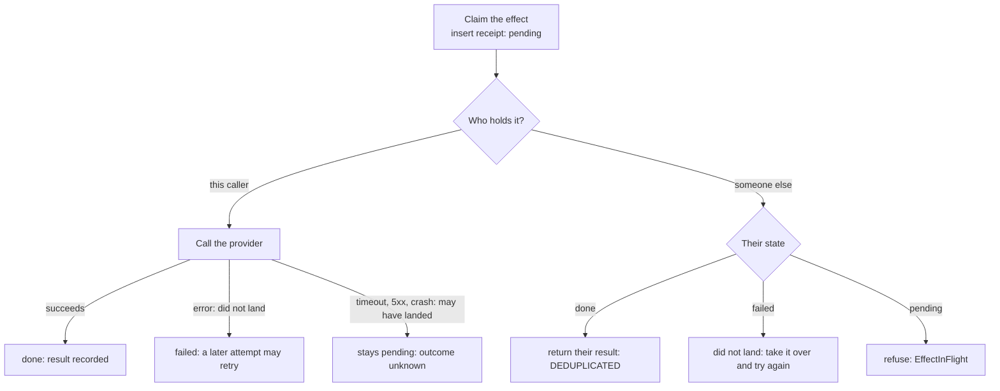

# Receipt Guarantees

A receipt is the durable record that a side effect was attempted. It is what
lets the gateway promise that the same effect happens once, even after a crash,
a restart, or a second worker.

## Contents

- [Storage](#storage)
- [What "the same effect" means](#what-the-same-effect-means)
- [Lifecycle](#lifecycle)
- [Resolving an unknown outcome](#resolving-an-unknown-outcome)
- [Provider interface](#provider-interface)
- [Recovery by action type](#recovery-by-action-type)
- [How this is verified](#how-this-is-verified)
- [Replays](#replays)

## Storage

Receipts are stored in SQLite (WAL mode) on a single host, or in PostgreSQL
across hosts. Both backends keep the same invariants, and the claim below is a
single transactional insert on either.

## What "the same effect" means

Each guarded destructive call is identified by an **effect key**: a fingerprint
of the action name and its arguments, plus an optional `effect_scope`. It does
not include the run, the process or the host. So these all produce the same
key, and only the first one executes:

- a retry after a crash
- a second worker picking up the same job
- the same request sent twice

Argument order, float drift and similar accidents do not change the key. Two
options change what counts as the same effect:

| Option | Use |
|---|---|
| `effect_scope="tenant-a"` | keep two tenants' identical actions apart |
| `identity_fields=("service", "title")` | only these arguments define the effect; others may change between retries |

## Lifecycle

The receipt is claimed **before** the action is sent:



| Receipt state | Meaning | Next attempt |
|---|---|---|
| `pending` | claimed; the outcome is not known yet | refused until resolved |
| `done` | the effect landed | gets the recorded result |
| `resolved` | settled by `resolve_unknown()`: it had landed | gets the recorded result |
| `failed` | the effect did not land | may run, reusing this receipt |

A receipt left `pending` after a crash means nobody knows whether the action
landed. Running it again risks a duplicate and reporting success may be wrong, so
the gateway refuses both until a person resolves it.

## Resolving an unknown outcome

`resolve_unknown()` asks the provider whether the effect already happened,
using the intent key it was sent with:

| Provider capability | Guarantee |
|---|---|
| Idempotency key and a lookup by key | effectively once: the provider settles it |
| Lookup by key, no idempotency | at most once: checked before any retry |
| Neither | no automatic retry; a person resolves it |

Exactly-once execution is not possible when the external system cannot support
or verify it. A receipt with no persisted target cannot be replayed; the
resolver raises `UnresolvableReceiptError` and asks for manual review rather
than guessing.

## Provider interface

For actions that need their own recovery logic, implement
`ExternalActionProvider`:

```python
execute(target, intent_key) -> provider_ref
find(intent_key, target=None) -> provider_ref | None
```

`target` is whatever the action acts on: a deployment, a file path, a row id.
`find` answers whether an uncertain action already happened, and is the only
part specific to your system.

| Adapter | Reconciliation |
|---|---|
| `HttpExternalActionProvider` | `POST /effects` to act, `GET /effects/{intent_key}` to look up |
| your own | whatever your system offers: a lookup by key, or replaying an idempotent request |

### Which failures may be retried

The question is whether the request could have reached the provider. Who
answers it depends on the way in:

| Failure | Classification | Receipt | Retry allowed |
|---|---|---|---|
| Connection refused, 4xx, an error in your own code | did not happen | `failed` | yes, with the same intent key |
| Timeout, connection reset or dropped, 5xx | may have happened | stays `pending` | no, settle first |
| `OutcomeUnknown` raised by your tool | may have happened | stays `pending` | no, settle first |
| Interrupted mid-call (Ctrl-C, exit), or the process dies | may have happened | stays `pending` | no, settle first |

The same rules apply to a wrapped tool, a provider's `execute`, and the MCP
proxy (where a call that was sent and got no answer counts as a timeout). A retry
of a `failed` effect takes the same receipt over, so the provider sees the same
idempotency key each time; of several retries at once, exactly one gets it.

A `pending` receipt is settled by `resolve_unknown()` when a provider can look it
up, or by a person after checking the real system:

```bash
agent-gateway receipts list --db data/runtime.db
agent-gateway receipts settle --db data/runtime.db --key KEY --done    # or --failed
```

The dashboard offers the same, under **Needs you → Held actions**. The settlement,
who made it and any reference are recorded in the run's timeline
(`receipt.settled`). A held action also shows who approved it and the evidence on that approval
(the read results the gateway collected), frozen when the approval was asked
for ([SDK guide](sdk.md#evidence-for-the-reviewer), which also lists its limits).
`agent-gateway receipts list` shows the held actions but not this evidence.

## Recovery by action type

| Action type | Recovery |
|---|---|
| Idempotent with lookup | finish by resolving the same intent |
| Reversible | compensate once the provider confirms the original action |
| Irreversible, no lookup | manual resolution |

Approval for destructive actions is a separate lock. Receipts only make the
side-effect lifecycle durable and recoverable.

## How this is verified

`make proof` runs the crash-safety suites against a local HTTP service:

- **crash safety:** 1,000 jobs, each crashed at a random point; no effect is
  applied twice
- **duplicate suppression:** one effect claimed by 1,000 different runs, each
  crashed at a random point; exactly one side effect lands

CI runs them on every push, and at the full 1,000 jobs every night.

## Replays

A replay is stored as a new record linked to the original
(`replay_of_trace_id`). The original record is never changed, so it stays as
evidence even when a replay succeeds.
