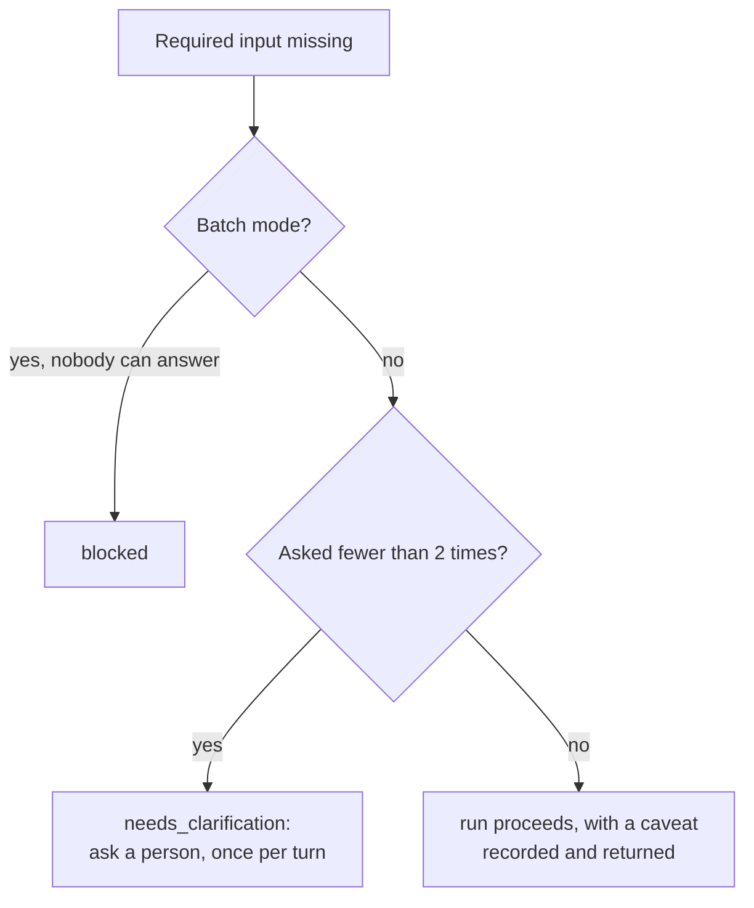
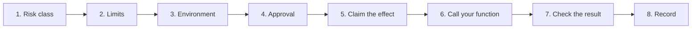

# SDK Guide

The SDK is how your agent gets its tools. Your application still owns the
agent, its model and its loop; the SDK decides what each tool call may do, and
records what happened.

## Contents

- [Sessions](#sessions)
- [Control](#control)
- [What every call goes through](#what-every-call-goes-through)
- [Results](#results)
- [Recording](#recording)
- [Other ways in](#other-ways-in)
- [Storage and dashboard](#storage-and-dashboard)
- [Limits of the SDK](#limits-of-the-sdk)

## Sessions

### Open a session and wrap tools

Every guarded tool comes from a session. The agent receives the wrapped
function, never the raw one, so it cannot route around the checks.

```python
from agent_action_gateway import session

with session(environment="prod") as ctx:
    drop = ctx.tool(drop_table, action="db.drop_table", risk="destructive")
    query = ctx.tool(run_query, action="db.query", risk="read")
    result = ctx.run(agent, task, tools={"drop_table": drop, "query": query})
```

### Session API

| Method | Purpose |
|---|---|
| `session(store=..., environment=..., limits=..., run_id=..., batch=...)` | open a session; every argument has a safe default |
| `ctx.tool(fn, action=..., risk=...)` | wrap a function so every call is checked |
| `ctx.run(agent, task, tools=..., required_inputs=...)` | run an agent with the guarded tools it may use |
| `ctx.request_approval(action, arguments)` | create an approval bound to those exact arguments |
| `ctx.approve(id, approver)` / `ctx.deny(id, approver)` | decide a pending approval |
| `ctx.pending_approvals()` | list approvals waiting on a person |
| `ctx.retrying(tool, attempts=...)` | retry transient failures, never refusals |
| `ctx.record_model_exchange(...)` | record a prompt and completion against the run |

### `ctx.tool` options

| Option | Default | Meaning |
|---|---|---|
| `action` | required | the action's name, used in approvals and records |
| `risk` | `"destructive"` | `"read"` needs no approval; anything else does |
| `target_environment` | none | where the tool acts: `dev`, `staging` or `prod` |
| `required_fields` | `()` | fields the tool's result must contain; a result without them is reported, not trusted |
| `estimated_cost_usd` | `0.0` | counted against the cost limit |
| `effect_scope` | `""` | keeps identical actions of different tenants apart |
| `identity_fields` | all arguments | the arguments that define "the same effect" |

## Control

### Approvals

```python
approval = ctx.request_approval("db.drop_table", {"table": "users"})
ctx.approve(approval.approval_id, "on-call engineer")

drop(table="orders", approval_id=approval.approval_id)  # blocked: approval was for "users"
drop(table="users", approval_id=approval.approval_id)   # allowed
```

| Property | Behaviour |
|---|---|
| Bound to arguments | a different payload is refused |
| Expires | after 15 minutes by default |
| Single use | a second call with the same approval is refused |

### Doing an effect once

Each destructive call gets an `intent_key`: a stable identifier for *what the
action is*, not which run attempted it. A retry after a crash, a second worker,
or the same request sent twice all produce the same key, and only the first
runs. Later attempts return the recorded result with `decision: DEDUPLICATED`.

If your function has an `intent_key` parameter (or `**kwargs`), the session
passes the key in. Hand it to your provider as its idempotency key:

```python
def drop_table(table: str, intent_key: str = "") -> dict:
    return db_admin.drop(table, idempotency_key=intent_key)
```

| Your function | Second call | Crash in the middle of the call |
|---|---|---|
| accepts `intent_key` | blocked | the provider can say whether it happened |
| does not | blocked | outcome marked unknown, left for a person |

Adjust what counts as "the same effect":

```python
# Two tenants must not suppress each other.
ctx.tool(write_config, action="config.write", effect_scope="tenant-a")

# Only these arguments define the effect; others may change between retries.
ctx.tool(open_ticket, action="ticket.open", identity_fields=("service", "title"))
```

See [receipt-guarantees.md](receipt-guarantees.md) for exactly what "once"
means.

### Limits

| Limit | Default | Applies to |
|---|---|---|
| Steps | 50 | guarded calls per run |
| Time | 600 seconds | the whole run, including an agent that never calls a tool |
| Cost | $2.00 | model and tool cost reported to the session |
| Repeats | 3 | the same action with the same arguments and no progress |

```python
from agent_action_gateway import FuseLimits, session

with session(limits=FuseLimits(max_steps=20, max_wall_seconds=120, max_dollars=0.50)) as ctx:
    ...
```

A run whose budget is already spent does not start.

### Environments

A session is `dev`, `staging` or `prod` (default `dev`). A tool that declares
`target_environment="prod"` cannot be called from a `staging` session.

### Stop and ask

Name the inputs a task cannot proceed without, with `None` for each one still
unknown. If any is missing, the agent is not called:

```python
result = ctx.run(agent, task, tools=tools, required_inputs={"deployment_id": None})
```



| `ctx.run(...)` option | Meaning |
|---|---|
| `required_inputs={"name": value}` | `None` or `""` counts as missing |
| `new_turn=True` | the person has replied; a new question is allowed |
| `batch=True` | nobody can answer, so a missing input blocks |

The count of questions is saved under the session's `run_id`, so it survives
across turns and processes. Open each turn with the same `run_id`.

### Retrying

Retrying is the easiest way to turn a limit into a suggestion, so `retrying()`
is asymmetric on purpose:

```python
restart = ctx.retrying(ctx.tool(restart_service, action="service.restart"), attempts=2)
```

| Outcome | Behaviour |
|---|---|
| Allowed, but a transient failure (`transient: true`, or a 5xx in the result) | retried up to `attempts` times |
| **Blocked** | **never retried** |

## What every call goes through

The checks run in this order. Steps 1 to 4 never call your function, so a
refusal there means no side effect at all.



| Check | When it fails |
|---|---|
| Action has no declared risk | treated as destructive |
| Limit reached, or the same call repeated with no progress | stopped before the action is sent |
| Different environment | blocked |
| Destructive action without a valid approval (missing, expired, used, or for other arguments) | blocked |
| Safety store unavailable for a write | blocked; reads continue |
| Effect already applied | the recorded result is returned; your function is not called again |
| An earlier attempt's outcome is unknown | blocked until it is resolved |
| Suspiciously empty result, with a cross-check configured | checked against a second source, then flagged |
| Result missing a `required_fields` entry | reported as `blocked` (`REPORT_PARTIAL`) with the `missing` fields; your function has already run |

## Results

### A guarded call

A guarded tool returns a dict rather than raising, so the agent can read what
happened and adjust:

| Key | Meaning |
|---|---|
| `status` | `allowed` or `blocked` |
| `decision` | `ALLOW`, `APPROVAL`, `FUSE`, `ENVIRONMENT`, `DISPATCH`, `DEDUPLICATED`, or a result-check name |
| `result` | your function's return value, or `None` when refused |
| `error` | why it was refused |
| `missing` | required fields the result did not contain |
| `needs_approval` | true when an approval would resolve the refusal |
| `risk` | the risk class applied |

### A run

| Key | Meaning |
|---|---|
| `status` | `completed`, `degraded`, `blocked`, `failed` or `needs_clarification` |
| `output` | what the agent returned |
| `error` | why the run stopped, if it did |
| `missing_fields` | with `needs_clarification`: what to ask for |
| `caveat` | the run proceeded without a required input |
| `decisions`, `blocked_decisions` | how many calls were checked, and refused |
| `pending_approvals` | approvals waiting on a person |

A blocked call makes the whole run `blocked`, whatever the agent says.

## Recording

### What is recorded

Every call is recorded, allowed or blocked, with its input and output redacted
before it is written. Each run also records how much of its budget it used.

The SDK does not own your model call, so record the model exchange yourself if
you want it in the audit:

```python
completion = call_your_model(prompt)
ctx.record_model_exchange(
    prompt, completion.text,
    tokens_in=usage.prompt_tokens, tokens_out=usage.completion_tokens,
    cost_usd=usage.cost, latency_ms=usage.elapsed_ms,
)
```

Tokens, keys, emails and other personal data are replaced before anything
reaches disk. A value you did not record stays empty, which means *not
captured*, not *zero*.

### Keeping the store small

```bash
agent-gateway prune --db data/runtime.db --older-than 30 --keep-latest 10 --dry-run
```

| Behaviour | Why |
|---|---|
| Discards prompt and completion text, keeps the row | the action, timing, cost and outcome stay as evidence |
| Marks rows `exchange_state=pruned` | "discarded" stays distinguishable from "never recorded" |
| Never touches receipts | they are the once-only guarantee |
| Never runs automatically, and refuses with no limit given | a silent retention policy is a silent deletion of evidence |

## Other ways in

### MCP

Many agents get tools over the Model Context Protocol instead of importing a
library. `agent-gateway mcp-serve` serves your configured routes as MCP tools
over stdio, with no MCP SDK required:

```bash
agent-gateway mcp-serve --config routes.json --db gateway.db
```

Every `tools/call` goes through the same policy as the HTTP gateway: the same
records, receipts and refusals. To register the tools with an MCP library you
already use:

```python
from agent_action_gateway.integrations.mcp import MCPToolBridge, tool_definitions

bridge = MCPToolBridge.from_policy(store, policy)
tools = tool_definitions(policy)   # register these with your MCP library
result = bridge.call_tool("deploy", {"ref": "v2"}, approval_id=approval_id)
```

### Custom action providers

For actions that need their own recovery logic, implement:

```python
execute(target, intent_key) -> provider_ref
find(intent_key, target=None) -> provider_ref | None
```

| Method | Does |
|---|---|
| `execute` | performs the action and returns the provider's reference for it |
| `find` | answers whether an uncertain action already happened |

`HttpExternalActionProvider` implements both for any HTTP service with
`POST /effects` and `GET /effects/{intent_key}`.

## Storage and dashboard

### Storage

| `--db` value | Backend | Use for |
|---|---|---|
| a file path | SQLite | one host |
| `postgresql://...` | PostgreSQL (`pip install 'agent-action-gateway[postgres]'`) | several hosts or gateway replicas |

Both run the same schema and migrations. `tests/test_backend_agreement.py`
runs the store checks on both and compares the answers; without
`AGENT_GATEWAY_TEST_POSTGRES` set, the PostgreSQL half skips visibly.

### Dashboard security

```bash
python -m agent_action_gateway.observability.dashboard --db data/runtime.db
```

| Protection | Detail |
|---|---|
| Access token | printed at start-up; needed on every route as `?token=` or `Authorization: Bearer` |
| Local by default | binds to `127.0.0.1`; any other address needs an explicit token |
| CSRF and origin checks | on every approval form; a POST from another site is refused |
| No scripts | the Content-Security-Policy allows none |

Restarting the dashboard invalidates tokens and open forms on purpose.

## Limits of the SDK

| It does not | Because |
|---|---|
| prevent hallucinations or judge a plan | it checks actions, not reasoning |
| guarantee exactly-once without provider idempotency or lookup | nobody can tell whether such an effect landed |
| replace human approval | it enforces it |
| control the agent's model calls | your application owns them |
| keep a key from an agent in the same process | that needs the [self-hosted gateway](gateway-deployment.md) |

For the release gate and run scoring, see [evaluation.md](evaluation.md).
