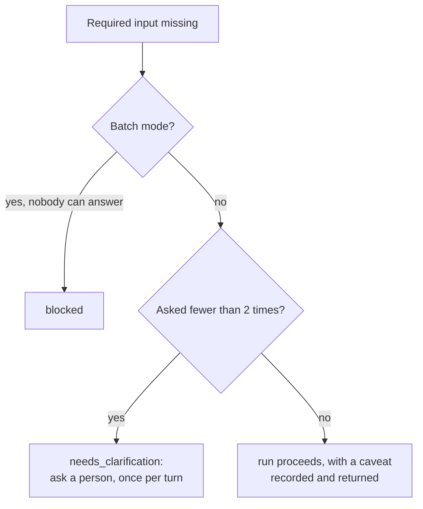
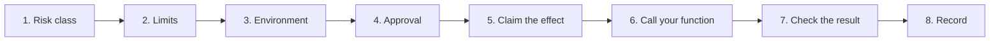

# SDK Guide

The SDK is how your agent gets its tools. Your application still owns the
agent, its model and its loop; the SDK decides what each tool call may do, and
records what happened.

## Contents

- [Sessions](#sessions)
- [Control](#control)
- [What every call goes through](#what-every-call-goes-through)
- [Results](#results)
- [Recording](#recording)
- [Other ways in](#other-ways-in)
- [Storage and dashboard](#storage-and-dashboard)
- [Limits of the SDK](#limits-of-the-sdk)

## Sessions

### Open a session and wrap tools

Every guarded tool comes from a session. The agent receives the wrapped
function, never the raw one, so it cannot route around the checks.

```python
from agent_action_gateway import session

with session(environment="prod") as ctx:
    drop = ctx.tool(drop_table, action="db.drop_table", risk="destructive")
    query = ctx.tool(run_query, action="db.query", risk="read")
    result = ctx.run(agent, task, tools={"drop_table": drop, "query": query})
```

### Session API

| Method | Purpose |
|---|---|
| `session(store=..., environment=..., limits=..., run_id=..., batch=...)` | open a session; every argument has a safe default |
| `ctx.tool(fn, action=..., risk=...)` | wrap a function so every call is checked |
| `ctx.run(agent, task, tools=..., required_inputs=...)` | run an agent with the guarded tools it may use |
| `ctx.request_approval(action, arguments)` | create an approval bound to those exact arguments |
| `ctx.approve(id, approver)` / `ctx.deny(id, approver)` | decide a pending approval |
| `ctx.pending_approvals()` | list approvals waiting on a person |
| `ctx.retrying(tool, attempts=...)` | retry transient failures, never refusals |
| `ctx.record_model_exchange(...)` | record a prompt and completion against the run |

### `ctx.tool` options

| Option | Default | Meaning |
|---|---|---|
| `action` | required | the action's name, used in approvals and records |
| `risk` | `"destructive"` | `"read"` needs no approval; anything else does |
| `target_environment` | none | where the tool acts: `dev`, `staging` or `prod` |
| `required_fields` | `()` | fields the tool's result must contain; a result without them is reported, not trusted |
| `estimated_cost_usd` | `0.0` | counted against the cost limit |
| `effect_scope` | `""` | keeps identical actions of different tenants apart |
| `identity_fields` | all arguments | the arguments that define "the same effect" |

## Control

### Approvals

```python
approval = ctx.request_approval("db.drop_table", {"table": "users"})
ctx.approve(approval.approval_id, "on-call engineer")

drop(table="orders", approval_id=approval.approval_id)  # blocked: approval was for "users"
drop(table="users", approval_id=approval.approval_id)   # allowed
```

| Property | Behaviour |
|---|---|
| Bound to arguments | a different payload is refused |
| Expires | after 15 minutes by default |
| Single use | a second call with the same approval is refused |

### Doing an effect once

Each destructive call gets an `intent_key`: a stable identifier for *what the
action is*, not which run attempted it. A retry after a crash, a second worker,
or the same request sent twice all produce the same key, and only the first
runs. Later attempts return the recorded result with `decision: DEDUPLICATED`.

If your function has an `intent_key` parameter (or `**kwargs`), the session
passes the key in. Hand it to your provider as its idempotency key:

```python
def drop_table(table: str, intent_key: str = "") -> dict:
    return db_admin.drop(table, idempotency_key=intent_key)
```

| Your function | Second call | Crash in the middle of the call |
|---|---|---|
| accepts `intent_key` | blocked | the provider can say whether it happened |
| does not | blocked | outcome marked unknown, left for a person |

Adjust what counts as "the same effect":

```python
# Two tenants must not suppress each other.
ctx.tool(write_config, action="config.write", effect_scope="tenant-a")

# Only these arguments define the effect; others may change between retries.
ctx.tool(open_ticket, action="ticket.open", identity_fields=("service", "title"))
```

See [receipt-guarantees.md](receipt-guarantees.md) for exactly what "once"
means.

### Limits

| Limit | Default | Applies to |
|---|---|---|
| Steps | 50 | guarded calls per run |
| Time | 600 seconds | the whole run, including an agent that never calls a tool |
| Cost | $2.00 | model and tool cost reported to the session |
| Repeats | 3 | the same action with the same arguments and no progress |

```python
from agent_action_gateway import FuseLimits, session

with session(limits=FuseLimits(max_steps=20, max_wall_seconds=120, max_dollars=0.50)) as ctx:
    ...
```

A run whose budget is already spent does not start.

### Environments

A session is `dev`, `staging` or `prod` (default `dev`). A tool that declares
`target_environment="prod"` cannot be called from a `staging` session.

### Stop and ask

Name the inputs a task cannot proceed without, with `None` for each one still
unknown. If any is missing, the agent is not called:

```python
result = ctx.run(agent, task, tools=tools, required_inputs={"deployment_id": None})
```



| `ctx.run(...)` option | Meaning |
|---|---|
| `required_inputs={"name": value}` | `None` or `""` counts as missing |
| `new_turn=True` | the person has replied; a new question is allowed |
| `batch=True` | nobody can answer, so a missing input blocks |

The count of questions is saved under the session's `run_id`, so it survives
across turns and processes. Open each turn with the same `run_id`.

### Retrying

Retrying is the easiest way to turn a limit into a suggestion, so `retrying()`
is asymmetric on purpose:

```python
restart = ctx.retrying(ctx.tool(restart_service, action="service.restart"), attempts=2)
```

| Outcome | Behaviour |
|---|---|
| Allowed, but a transient failure (`transient: true`, or a 5xx in the result) | retried up to `attempts` times |
| **Blocked** | **never retried** |

## What every call goes through

The checks run in this order. Steps 1 to 4 never call your function, so a
refusal there means no side effect at all.



| Check | When it fails |
|---|---|
| Action has no declared risk | treated as destructive |
| Limit reached, or the same call repeated with no progress | stopped before the action is sent |
| Different environment | blocked |
| Destructive action without a valid approval (missing, expired, used, or for other arguments) | blocked |
| Safety store unavailable for a write | blocked; reads continue |
| Effect already applied | the recorded result is returned; your function is not called again |
| An earlier attempt's outcome is unknown | blocked until it is resolved |
| Suspiciously empty result, with a cross-check configured | checked against a second source, then flagged |
| Result missing a `required_fields` entry | reported as `blocked` (`REPORT_PARTIAL`) with the `missing` fields; your function has already run |

## Results

### A guarded call

A guarded tool returns a dict rather than raising, so the agent can read what
happened and adjust:

| Key | Meaning |
|---|---|
| `status` | `allowed` or `blocked` |
| `decision` | `ALLOW`, `APPROVAL`, `FUSE`, `ENVIRONMENT`, `DISPATCH`, `DEDUPLICATED`, or a result-check name |
| `result` | your function's return value, or `None` when refused |
| `error` | why it was refused |
| `missing` | required fields the result did not contain |
| `needs_approval` | true when an approval would resolve the refusal |
| `risk` | the risk class applied |

### A run

| Key | Meaning |
|---|---|
| `status` | `completed`, `degraded`, `blocked`, `failed` or `needs_clarification` |
| `output` | what the agent returned |
| `error` | why the run stopped, if it did |
| `missing_fields` | with `needs_clarification`: what to ask for |
| `caveat` | the run proceeded without a required input |
| `decisions`, `blocked_decisions` | how many calls were checked, and refused |
| `pending_approvals` | approvals waiting on a person |

A blocked call makes the whole run `blocked`, whatever the agent says.

## Recording

### What is recorded

Every call is recorded, allowed or blocked, with its input and output redacted
before it is written. Each run also records how much of its budget it used.

The SDK does not own your model call, so record the model exchange yourself if
you want it in the audit:

```python
completion = call_your_model(prompt)
ctx.record_model_exchange(
    prompt, completion.text,
    tokens_in=usage.prompt_tokens, tokens_out=usage.completion_tokens,
    cost_usd=usage.cost, latency_ms=usage.elapsed_ms,
)
```

Tokens, keys, emails and other personal data are replaced before anything
reaches disk. A value you did not record stays empty, which means *not
captured*, not *zero*.

### Keeping the store small

```bash
agent-gateway prune --db data/runtime.db --older-than 30 --keep-latest 10 --dry-run
```

| Behaviour | Why |
|---|---|
| Discards prompt and completion text, keeps the row | the action, timing, cost and outcome stay as evidence |
| Marks rows `exchange_state=pruned` | "discarded" stays distinguishable from "never recorded" |
| Never touches receipts | they are the once-only guarantee |
| Never runs automatically, and refuses with no limit given | a silent retention policy is a silent deletion of evidence |

## Other ways in

### MCP proxy

Many agents get tools from MCP servers instead of importing a library. The MCP
proxy sits between such an agent and those servers. The agent connects to the
proxy and to nothing else. The proxy connects, as a client, to the servers you
list (a command it starts, or a remote URL), merges their tools into one list
(named `server__tool`), and runs every call through the same checks as the
library: limits, environment, approval and once-only effects. It uses no MCP SDK.

```bash
agent-gateway mcp-proxy --config servers.json --db gateway.db
```

`servers.json` lists the servers. The `mcpServers` block that Claude Desktop and
Cursor use works as it is:

```json
{
  "environment": "staging",
  "servers": {
    "db": { "command": "npx", "args": ["-y", "some-postgres-mcp"], "environment": "staging" },
    "tickets": { "url": "https://mcp.example.com/mcp",
                 "headers": { "Authorization": "Bearer ${TICKETS_TOKEN}" } }
  },
  "rules": [
    { "match": "db__list_*", "risk": "read" }
  ],
  "require": [
    { "match": "db__run_*", "arguments": ["target_database"] }
  ],
  "limits": { "max_steps": 200 }
}
```

- **Tools are discovered.** You do not write routes. At start-up the proxy asks
  each server for its tools and prints each one with its risk class on stderr.
- **Local and remote servers.** `command` starts a local server over stdio.
  `url` connects to a remote server over Streamable HTTP, with the `headers` you
  give. `${NAME}` in any value is read from the environment, so a token never
  sits in the file. A server that cannot start stops the proxy.
- **OAuth.** For a remote server that wants a token from an authorization server,
  use the client-credentials grant instead of an `Authorization` header:
  `"oauth": { "token_url": "https://auth.example.com/token", "client_id": "...",
  "client_secret": "${TICKETS_SECRET}", "scope": "tools" }`. The proxy fetches a
  token, reuses it until shortly before it expires, and fetches a new one if the
  server rejects it (once). The secret is never printed or kept in an error.
- **Browser sign-in.** For a server that needs a person to sign in once (OAuth
  authorization code with PKCE), use `"flow": "authorization_code"` with the
  server's `authorization_url`, `token_url`, `client_id` and a `token_file`
  (`client_secret` and `redirect_port` are optional):

  ```bash
  agent-gateway mcp-login --config servers.json --server tickets
  ```

  This opens your browser, waits for the redirect back on `127.0.0.1`, and saves the
  tokens in `token_file` (mode 0600; a file others can read is refused). The proxy
  then uses them and refreshes them when they expire, or once if the server rejects
  them. If there is no sign-in, or it cannot be refreshed, the proxy says to run
  `mcp-login`. You give the endpoints yourself: finding them from the server and
  registering a client automatically is not supported.
- **Sessions.** If a remote server forgets the proxy's session (HTTP 404), the
  proxy starts a new one and sends the same message again. That is safe because a
  server that does not know the session has not acted on the message.
- **Tool-list changes.** A remote server may announce changes on the optional
  stream a client can open with a GET. The proxy opens it, and if the server has
  none it stops asking. Changed tools go through pinning like any other.
- **Local servers that die.** If a local server has stopped, the proxy restarts it
  before the next call, reads its tools again and checks them against the pins. It
  does not restart a server more than three times a minute. A call that was in
  flight when the server died is not repeated; see "If a call times out" below.
- **Risk classes.** The first rule that matches the name wins. With no rule, a
  tool is `read` only if its server marks it `readOnlyHint` and the server has
  `trust_hints` on (the default). Everything else is destructive and needs an
  approval.
- **Pinned definitions.** A server's hint is its own claim, and the MCP
  specification says clients should not trust annotations from servers they do
  not trust. So the first time the proxy sees a server, it pins each tool's full
  definition. If a tool's definition later changes, or a new tool appears on a
  server that was already pinned, the tool is hidden from the agent and refused
  until a person accepts it:

  ```bash
  agent-gateway mcp-pins list --db gateway.db
  agent-gateway mcp-pins accept --db gateway.db --tool db__run_sql   # or no --tool for all
  ```

  Pins are kept in the database, so a change made while the proxy was stopped is
  caught at the next start. Set `"trust_hints": false` for a server you do not
  trust at all, and use rules instead.
- **Stop and ask.** A call that is missing an argument the tool's schema
  requires (or that `require` lists) is refused before any step is spent or any
  approval is created. The agent is told what is missing and to ask the user, and
  the refusal is recorded. Unlike the library, the proxy does not go on after
  two questions: it keeps refusing.
- **Approvals.** A blocked call returns an error with an approval id. Approve it
  in `agent-gateway dashboard --db gateway.db`, then the agent repeats the same
  call and the proxy finds the approval itself. The approval covers those exact
  arguments and works once. A client that wants to pass an id can put it in
  `params._meta["agent-action-gateway/approval_id"]`. Tool arguments are never
  read for checks, so any argument name is safe.
- **Repeats.** If the same action already ran, it is not run again. The agent gets
  a redacted copy of the first result (up to 16 KB), or a message saying it ran
  if the result was larger.
- **Hot reload.** The config file is watched. Adding, removing or changing a
  server, a rule or a `require` entry applies within about a second, and the
  agent's client is told the tool list changed (a client that ignores that
  notification sees the new list the next time it asks). A server that cannot
  start leaves the running setup as it was. `environment` and `limits` need a
  restart. A server that announces its own tool changes is picked up too.
- **Environment.** `environment` is the session's. A server's own `environment`
  is where its tools act; a non-production session cannot reach `prod`.
- **Limits.** One proxy process is one budget. The defaults are 500 steps and
  one hour; change them under `limits`.
- **If a call times out or the server dies,** the result is unknown. The attempt
  stays unfinished and the same call is refused until a person settles it.
- **Keys.** The proxy holds no key of its own. To keep a key away from the agent
  as well, let the gateway hold it and point the proxy at the gateway's MCP
  endpoint:

  ```json
  { "servers": { "ops": { "url": "http://127.0.0.1:8080/mcp",
                          "headers": { "Authorization": "Bearer ${GATEWAY_VIRTUAL_KEY}" } } } }
  ```

  The gateway serves its routes as MCP tools at `/mcp`. A virtual key sees only
  the routes it is scoped to, and a route marked `read` is listed as read-only.
  The proxy runs the checks; the gateway adds the real credential and makes the
  call. The proxy sends its idempotency key along, and the gateway passes it
  upstream as `Idempotency-Key`. The gateway must not run its own approval check
  as well, or the same call would need two approvals: use a route file with a
  `credentials` block (see `deploy/routes.credentials.example.json`). The
  separation only holds if the agent cannot read the gateway's secrets or the
  proxy's config; see the [gateway guide](gateway-deployment.md). This path is
  tested with the real `agent-gateway gateway` process started from a route file.
- **Boundary.** The proxy checks only what goes through it. Remove any direct
  connection from the agent to the real servers.
- **Not supported yet:** finding a remote server's sign-in endpoints automatically
  (OAuth discovery and client registration), and connecting to servers over
  anything but stdio and Streamable HTTP.
- **Tested with:** this project's tests, the official Python MCP SDK client, and
  one run of Claude Code (with a stand-in database tool). It has not been run with
  Claude Desktop or Cursor.

### Route-based MCP server

`agent-gateway mcp-serve` serves the routes of a gateway route file as MCP tools
over stdio. Each call goes through the gateway, so it checks the environment and
(in the default mode) approval, but not limits or once-only effects. Use the
proxy above for the full checks.

```bash
agent-gateway mcp-serve --config routes.json --db gateway.db
```

To register the tools with an MCP library you already use:

```python
from agent_action_gateway.integrations.mcp import MCPToolBridge, tool_definitions

bridge = MCPToolBridge.from_policy(store, policy)
tools = tool_definitions(policy)   # register these with your MCP library
result = bridge.call_tool("deploy", {"ref": "v2"}, approval_id=approval_id)
```

### Custom action providers

For actions that need their own recovery logic, implement:

```python
execute(target, intent_key) -> provider_ref
find(intent_key, target=None) -> provider_ref | None
```

| Method | Does |
|---|---|
| `execute` | performs the action and returns the provider's reference for it |
| `find` | answers whether an uncertain action already happened |

`HttpExternalActionProvider` implements both for any HTTP service with
`POST /effects` and `GET /effects/{intent_key}`.

## Storage and dashboard

### Storage

| `--db` value | Backend | Use for |
|---|---|---|
| a file path | SQLite | one host |
| `postgresql://...` | PostgreSQL (`pip install 'agent-action-gateway[postgres]'`) | several hosts or gateway replicas |

Both run the same schema and migrations. `tests/test_backend_agreement.py`
runs the store checks on both and compares the answers; without
`AGENT_GATEWAY_TEST_POSTGRES` set, the PostgreSQL half skips visibly.

### Dashboard security

```bash
agent-gateway dashboard --db data/runtime.db
```

| Protection | Detail |
|---|---|
| Access token | printed at start-up; needed on every route as `?token=` or `Authorization: Bearer` |
| Local by default | binds to `127.0.0.1`; any other address needs an explicit token |
| CSRF and origin checks | on every approval form; a POST from another site is refused |
| No scripts | the Content-Security-Policy allows none |

Restarting the dashboard invalidates tokens and open forms on purpose.

## Limits of the SDK

| It does not | Because |
|---|---|
| prevent hallucinations or judge a plan | it checks actions, not reasoning |
| guarantee exactly-once without provider idempotency or lookup | nobody can tell whether such an effect landed |
| replace human approval | it enforces it |
| control the agent's model calls | your application owns them |
| keep a key from an agent in the same process | that needs the [self-hosted gateway](gateway-deployment.md) |

For the release gate and run scoring, see [evaluation.md](evaluation.md).
